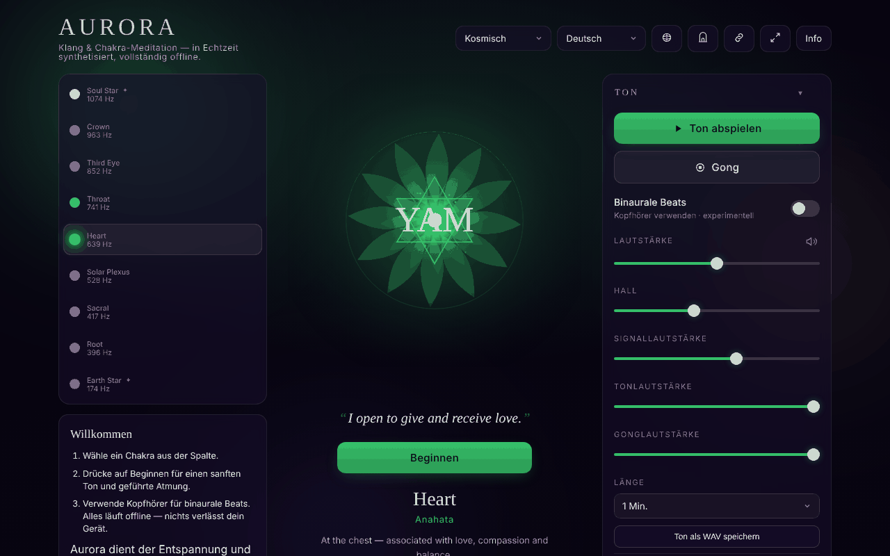

# Aurora

[English](README.md) · [Română](README.ro.md) · [Français](README.fr.md) · [Italiano](README.it.md) · [Español](README.es.md) · [Português](README.pt.md) · **Deutsch** · [Magyar](README.hu.md)

**Version:** 1.3.7 · **Zuletzt aktualisiert:** 2026-10-23

Oberflächensprachen: **Română, English, Français, Italiano, Español, Português (PT), Deutsch, Magyar, Català, हिन्दी, العربية**

Chakra Sound & Meditation — Töne, binaurale Beats, Atemführung und Reise durch die Chakren, in einer einzigen HTML-Datei.

**Online-App:** https://chiuta.github.io/Aurora/

## Was es ist

Aurora ist ein kontemplatives Klang- und Meditationswerkzeug: Du wählst ein Chakra, und die Anwendung erzeugt im Browser einen Ton (Web Audio API) mit der zugehörigen Frequenz, ein animiertes Mandala, optional binaurale Beats, einen Gong, eine Intervallglocke und eine Atemführung. Die Anwendung weist in der Oberfläche darauf hin, dass sie der Entspannung und Kontemplation dient und dass die Frequenzen und Chakren aus spirituellen Traditionen stammen, nicht aus der Medizin.

## Funktionen

- Chakra-Auswahl mit Angaben zu Frequenz, Element, Mantra, Blütenblättern, Solfeggio, „sense“ und Ton.
- Tonerzeugung, Lautstärkeregelung, Hall, getrennte Lautstärken für Hinweise, Ton und Gong; Gong auf Abruf.
- Binaurale Beats (Kopfhörer empfohlen), mit Voreinstellungen Delta 2 Hz, Theta 6 Hz, Alpha 10 Hz und weiteren.
- Sitzung mit einstellbarer Dauer; „Chakra journey“ (automatische Reise durch die Chakren), Optionen: automatischer Ausgleich, Einbeziehung der transpersonalen Chakren (9 statt 7 Chakren), absteigender Durchgang (vom Kronenchakra zur Wurzel), Intervallglocke.
- Atemführung mit wählbaren Mustern und Hinweisen bei Phasenwechseln.
- Affirmationen unter dem Mandala (optional), einfacher Modus (blendet die erweiterten Steuerelemente aus), Zen-/Vollbildmodus, Bildschirm bleibt eingeschaltet (Wake Lock, wo unterstützt).
- Verlauf der letzten Sitzungen, Voreinstellungen, Design.
- Fenster „Gateway practices“, Fenster mit Tastenkürzeln und Atemtutorial.
- Export / Import / Zurücksetzen der Einstellungen (JSON-Datei).
- Der Tab-Titel zeigt „▶ Chakra · Frequenz“, solange der Ton klingt, und die Media-Session-Metadaten (Titel, Wiedergabe/Pause) werden lokal für die Systemsteuerung gesetzt, wo der Browser sie anzeigt.
- Drucken: Das Druckstylesheet behält nur den Titel, die Affirmation und das Datenblatt des gewählten Chakras, dazu die Hinweise zu Rechten und die Warnung, ohne Schaltflächen.
- Oberfläche in 11 Sprachen: Englisch, Rumänisch, Spanisch, Französisch, Italienisch, Portugiesisch, Deutsch, Ungarisch, Katalanisch, Hindi, Arabisch.

## Neue Funktionen (1.1.0)

- **Der aktuelle Ton als WAV-Datei** (Bereich „Tone“, Abschnitt „Audio file“, im einfachen Modus ausgeblendet): Du wählst die Dauer (1, 2, 3 oder 5 Minuten), und die Anwendung erzeugt mit `OfflineAudioContext` denselben Ton wie den wiedergegebenen (dieselben Oszillatoren, derselbe Filter und dieselben LFOs), plus die binauralen Beats, falls aktiv, mit dem aktuellen Hall. Ergebnis: Stereo-WAV, 16 Bit, 32 kHz, auf −1 dBFS normalisiert, mit 1,5 s Einblendung und ~2,5 s Ausblendung; Name der Form `aurora-heart-639hz-binaural6.wav`. Er **enthält nicht** den Gong, die Intervallglocke und die Atemhinweise. Die 5 Minuten belegen ~38 MB und werden im Arbeitsspeicher erzeugt (auf alten Telefonen kann das scheitern: Die Anwendung meldet dann, dass der Browser die Datei nicht erzeugen konnte). Der Hall verwendet einen zufälligen Impuls, daher sind zwei nacheinander erzeugte Dateien nicht bitgenau identisch.
- **QR-Code der Szene** (Bereich „Session“, „QR code of this scene“): Der Code enthält die öffentliche Adresse (`https://chiuta.github.io/Aurora/` oder die der aktuellen Seite, wenn sie über HTTPS bereitgestellt wird) und einen Hash `#<Chakra>&beat=<2|6|10>&breath=<Muster>`. Beim Öffnen werden das Chakra, die binauralen Beats (wenn der Link sie verlangt) und das Atemmuster angewendet; unbekannte Werte werden ignoriert. Der Link kann auch kopiert werden. Das Muster „custom“ ist nicht im Link enthalten (es lässt sich nicht darstellen). Lokal erzeugt; erscheint nur mit dem QR-Modul.
- **Transparenz** und **`.fff.json`-Sicherungskopie** (die Version im Fenster „About“ drücken): das Standardfenster „ohne Grenzen“ mit dem Netzwerk (0 externe Anfragen), den Schlüsseln `aurora.*`, den Berechtigungen und dem SHA-256; die verschlüsselbare Sicherungskopie umfasst alle Einstellungen.

Die neuen Texte liegen in den 11 Sprachen der Anwendung vor (EN, RO, ES, FR, IT, PT, DE, HU, CA, HI, AR); die Übersetzungen außer EN/RO sind maschinell erstellt und **nicht muttersprachlich geprüft**.

## Das Kit „fff-kit“

In `index.html` eingefügte Module: `core`, `label`, `bundle`, `qr`. Das Fenster „Transparenz“ des Kits gibt es in 8 Sprachen (RO, EN, FR, IT, ES, PT, HU, DE); wenn die Anwendung auf CA, HI oder AR steht, erscheint es auf Englisch. Ohne das Kit funktioniert die Anwendung genauso, jedoch ohne die QR-Schaltfläche.

## Tests

`node tests/fff-r8.test.mjs` (Playwright, Netzwerk gesperrt): Die WAV-Datei wird im Test heruntergeladen und spektral analysiert (Header, Dauer, Pegel, Spitze bei der Chakra-Frequenz, L=220 Hz und R=220+Beat Hz bei binaural), die Szene wird in einen QR-Code kodiert, wieder dekodiert und in einer sauberen Seite erneut geöffnet, 9 Sprachen (einschließlich RTL-Arabisch), axe-core 0 Verstöße in den 3 Designs und im Modal, 360 px, ohne das Kit.

## Anleitung

1. Öffne die Seite und lies den Eingangshinweis; drücke „Got it“ (oder das Äquivalent in der gewählten Sprache). Beim ersten Start erscheint eine Willkommensanleitung („Welcome“ / „Begin“).
2. Wähle die Sprache mit der Sprachschaltfläche in der Kopfzeile oder drücke `L`, um zur nächsten zu wechseln.
3. Wähle ein Chakra (die Pfeile Auf/Ab wechseln das Chakra).
4. Drücke die Leertaste, um den Ton zu starten/zu stoppen; `G` schlägt den Gong an.
5. Regle die Lautstärke mit `+` / `-` oder über die Regler „Volume“, „Reverb“, „Tone volume“, „Gong volume“.
6. Öffne für binaurale Beats den Abschnitt „Binaural beats“, wähle „Beat“ und verwende Kopfhörer.
7. Wähle für die Atmung ein Muster unter „Breathing“; `B` wechselt zum nächsten Muster; `?` öffnet die Atemanleitung.
8. Stelle in „Session“ die „Duration“ und, falls gewünscht, „Chakra journey“ ein.
9. Escape schließt die Fenster und beendet den Zen-Modus.
10. Daten sichern: „Export settings“ lädt `aurora-settings.json` herunter; „Import settings“ lädt sie wieder ein; „Reset to defaults“ kehrt zu den Standardwerten zurück.

## Warnhinweis

Kontemplativer/entspannender Inhalt, nicht medizinisch. Die Chakren, die zugehörigen Frequenzen und die „heilenden Klänge“ stammen aus spirituellen Traditionen und haben keine wissenschaftliche Validierung; es gibt keine soliden Belege dafür, dass bestimmte Frequenzen Erkrankungen behandeln oder dass binaurale Beats den Zustand des Gehirns verlässlich verändern. Er ersetzt keinen ärztlichen Rat. Die Anwendung zeigt diesen Hinweis beim ersten Start, in „About“ und in der Fußzeile der Seite an.

## Datenschutz und Netzwerk

- **Lokaler Speicher:** `localStorage`, alle Schlüssel mit dem Präfix `aurora.` (Sprache, Design, Lautstärken, Sitzungseinstellungen, Voreinstellungen, Verlauf, Markierungen, dass die Hinweise gesehen wurden). Ist der Speicher gesperrt, zeigt die Anwendung eine Warnung an.
- **Netzwerk:** Im Code der Anwendung gibt es kein `fetch`, kein CDN, keine automatisch geladenen Skripte oder externen Ressourcen; ich habe keine Analytics gefunden. Der Ton wird lokal synthetisiert.
- Die Anwendung enthält im Hinweis „About“ einen Textverweis auf das Centrul AmaneSer (amaneser.ro), ohne von dort Ressourcen zu laden.

## Lokale Ausführung / offline

Lade `index.html` herunter und öffne sie in einem Browser. Sie benötigt kein Internet zum Funktionieren. Ein Server ist nicht nötig.

## Lizenz

MIT für den Code und die Struktur der Anwendung — siehe die Datei `LICENSE`. Eventuell in der Datei enthaltene Bibliotheken von Drittanbietern behalten ihre eigenen Lizenzen.

Die Erklärung steht auch im Kopf von `index.html` und in der Fußzeile der Anwendung (RO + EN).

## Rechte und Quellenangabe

- **Anteil des Autors:** der Code, die Texte und das Design der Anwendung (Alexio — Alexandru-Ionuț Chiuță). Jede später erklärte Lizenz gilt nur für diesen Anteil.
- **Dritte / Inspiration:** Die Anwendung ist von der Praxis der Klänge zur Entspannung inspiriert (z. B. dem Centrul AmaneSer, amaneser.ro — von dort werden keine Ressourcen geladen) und erwähnt die „Gateway“-Praxis (Monroe Institute). Es ist ein unabhängiges Projekt; es impliziert keine Zugehörigkeit oder Billigung seitens dieser und gibt nicht die offizielle Position irgendeiner Organisation wieder.
- Die Rechte an Materialien und Namen Dritter gehören ihren Inhabern.
- **Berichtigung / Rücknahme:** Wenn du Rechteinhaber oder eine erwähnte Person bist und eine Berichtigung oder Rücknahme wünschst, schreibe an alexio@trom.tf; wir antworten innerhalb von 7 Tagen.

*Rechte und Quellenangabe:* Code, Texte und Design stammen vom Autor; jede später erklärte Lizenz gilt nur für diesen Teil. Inspirationen/Erwähnungen (Centrul AmaneSer, Monroe Institute „Gateway“) implizieren keine Zugehörigkeit oder Billigung; die Rechte an Materialien und Namen Dritter gehören ihren Inhabern. Rechteinhaber oder erwähnte Personen: Schreibt an alexio@trom.tf für Berichtigung oder Entfernung; wir antworten innerhalb von 7 Tagen.

## Audit

Audit: 2026-10-10 — geprüft mit Playwright und axe-core; CSP `default-src 'none'` bestätigt; kein `fetch`/CDN. Runde 3 (2026-10-11): Erklärung zur nicht festgelegten Lizenz + „Rechte und Quellenangabe“ in Anwendung und README. Korrigiert: horizontaler Überlauf auf Mobilgeräten, zugängliche Namen für die Chakra-Schaltflächen; dauerhafte Warnung in der Fußzeile ergänzt. Runde 2 (2026-10-11): Meta-Description umformuliert (ohne „healing“: ein Entspannungswerkzeug, keine Behandlung); `<html lang>` wird bereits beim Sprachwechsel aktualisiert.

## Verlauf / Changelog

- 1.3.7 — 2026-10-23: i18n-Parität: die fehlende Beschriftung `chakraNav` für Katalanisch, Hindi und Arabisch wurde ergänzt; der Schlüssel `cwBtn` (zur Laufzeit für alle Sprachen ergänzt) ist in `fff.config.json` als Ausnahme dokumentiert
- 1.3.5 — 2026-10-22: fff-kit 1.1.4: Touch-Ziele und Mindestschriftgröße; Touch-Ziele/Text korrigiert
- 1.3.4 — 2026-10-22: fff-kit 1.1.2: PBKDF2 mit 600.000 Iterationen, Schutz vor Clickjacking
- 1.3.3 — 2026-10-22: Chakra-Beschriftungen, Panel-Hinweise und Metadaten-Labels verwenden Text von mindestens 12 px; Touch-Ziele von mindestens 24 px (Kontrollkästchen, Fußzeilenlinks).

- 1.3.2 — 2026-10-22: **Korrektur**: der zugängliche Name der Chakra-Auswahl folgt jetzt der Oberflächensprache.
### 1.3.1 — 2026-10-22
- Deutsch und Ungarisch zeigen jetzt übersetzte Chakra-Namen, Elemente, Affirmationen, Beschreibungen und Sinne (sie waren noch englisch).

### 19. Oktober 2026 (v1.2.0)
- Schaltfläche „Ambient-Version in CalmWaves“ (neuer Tab): übergibt den Zweck (Schlaf/Entspannung/Konzentration je nach binauralem Beat, „Meditation“ ohne Binaural), die Dauer und die Chakra-Frequenz in der CalmWaves-Adresse (`?v=…&from=aurora`). Nur ein Link, keine Netzwerkanfragen.

### 14. Oktober 2026 (v1.1.0)
- Neu: der aktuelle Ton als WAV, QR-Code der Szene (Chakra + binaurale Beats + Atmung) und erweiterter Hash `#Chakra&beat=…&breath=…`, Fenster „Transparenz“ (fff-kit: core, label, bundle, qr); `tests/fff-r8.test.mjs`. CSP: Hash des Skripts neu berechnet.

### 1.0.0 — 2026-10-12
- Version und Datum der letzten Aktualisierung werden in der Anwendung angezeigt (Fenster „Über“, in den 11 Sprachen).

### 11. Oktober 2026 (Runde 7)
- Verbessert: Beim ersten Öffnen (ohne gespeichertes Design) berücksichtigt die Anwendung die Systemeinstellungen: Design „light“, wenn das System das helle Schema verlangt, „contrast“, wenn es erhöhten Kontrast verlangt (`prefers-color-scheme` / `prefers-contrast`); die manuelle Wahl hat Vorrang und bleibt erhalten. Geprüft: 0 axe-core-Verstöße in den Designs light und contrast.
- Geprüft, kein Defekt: Die Schaltfläche „Begin“ wird ausgeblendet, solange der Ton klingt (beabsichtigtes Verhalten; Wiedergabe/Pause bleibt sichtbar) und erscheint bei Pause wieder.

### 11. Oktober 2026 (Runde 6)
- Sicherheit: CSP `script-src` auf den SHA-256-Hash des einzigen Skripts, ohne `'unsafe-inline'` für Skripte (Inline-Stile bleiben erlaubt).
- Ergänzt: Der Tab-Titel und die Media Session spiegeln das Chakra und den Wiedergabezustand wider; Druckstylesheet.

### 11. Oktober 2026
- Behoben: Der Inhalt ist jetzt in Landmarks (`<main>`, `<footer>`) gefasst, sodass die axe-core-Regel „region“ bestanden wird; 0 Verstöße bei 1280 und 360 px.
- Hinweis (unverändert): Die Zuordnungen Chakra–Frequenz/Element/„sense“ stammen aus spirituellen Traditionen, nicht aus wissenschaftlichen Quellen, wie der in der Anwendung angezeigte Hinweis sagt; der Klang konnte in den automatisierten Tests nicht per Gehör beurteilt werden.

## Autor

Alexio — Alexandru-Ionuț Chiuță, Kontakt: alexio@trom.tf

## Zusammenfassung

Aurora ist ein einteiliges Chakra-Klang- und Meditationswerkzeug: synthetisierte Töne (Web Audio), binaurale Beats, Gong, Atemführung, automatische Chakra-Reise, Sitzungsverlauf, Export/Import der Einstellungen und eine Oberfläche in 11 Sprachen. Einstellungen werden in localStorage unter dem Präfix `aurora.` gespeichert; die App stellt keine Netzwerkanfragen. Sie dient der Entspannung, nicht der Medizin.

Neu in 1.1.0: den aktuellen Ton als 16-Bit-Stereo-WAV speichern (1–5 Min., offline im Browser erzeugt; ohne Gong, Glocken und Atemhinweise), ein QR-Code/Link für die aktuelle Szene (Chakra + binauraler Beat + Atemmuster) und der Dialog „Transparenz“. Die Übersetzungen der neuen Zeichenketten außer EN/RO sind maschinell erstellt und nicht muttersprachlich geprüft.
