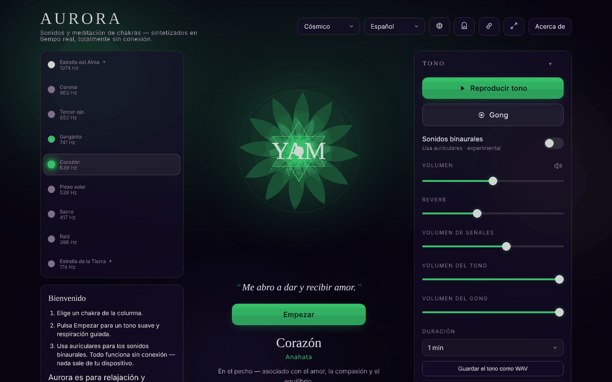

# Aurora

[English](README.md) · [Română](README.ro.md) · [Français](README.fr.md) · [Italiano](README.it.md) · **Español** · [Português](README.pt.md) · [Deutsch](README.de.md) · [Magyar](README.hu.md)

**Versión:** 1.3.4 · **Última actualización:** 2026-10-22

Idiomas de la interfaz: **Română, English, Français, Italiano, Español, Português (PT), Deutsch, Magyar, Català, हिन्दी, العربية**

Chakra Sound & Meditation — tonos, pulsos binaurales, guía de respiración y viaje a través de los chakras, en un único archivo HTML.

**Aplicación en línea:** https://chiuta.github.io/Aurora/

## Qué es

Aurora es una herramienta contemplativa de sonido y meditación: eliges un chakra, y la aplicación genera en el navegador un tono (Web Audio API) con la frecuencia asociada, un mandala animado, opcionalmente pulsos binaurales, un gong, una campanilla a intervalos y una guía de respiración. La aplicación precisa en la interfaz que es para la relajación y la contemplación, y que las frecuencias y los chakras proceden de tradiciones espirituales, no de la medicina.

## Funciones

- Selección de chakras con información sobre frecuencia, elemento, mantra, pétalos, solfeggio, «sense» y tono.
- Generación de tono, ajuste de volumen, reverberación, volúmenes separados para las indicaciones, el tono y el gong; gong a demanda.
- Pulsos binaurales (se recomiendan auriculares), con ajustes preestablecidos Delta 2 Hz, Theta 6 Hz, Alpha 10 Hz y otros.
- Sesión con duración configurable; «Chakra journey» (viaje automático a través de los chakras), opciones: equilibrado automático, inclusión de los chakras transpersonales (9 chakras en lugar de 7), recorrido descendente (de la corona a la raíz), campanilla a intervalos.
- Guía de respiración con patrones seleccionables e indicaciones en los cambios de fase.
- Afirmaciones mostradas bajo el mandala (opcional), modo simple (oculta los controles avanzados), modo zen/pantalla completa, pantalla que permanece encendida (Wake Lock, donde sea compatible).
- Historial de sesiones recientes, ajustes preestablecidos, tema.
- Ventana «Gateway practices», ventana de atajos y tutorial de respiración.
- Exportación / importación / restablecimiento de los ajustes (archivo JSON).
- El título de la pestaña muestra «▶ chakra · frecuencia» mientras suena el tono, y los metadatos de Media Session (título, reproducir/pausa) se establecen localmente para los controles del sistema, donde el navegador los muestre.
- Impresión: la hoja de estilo de impresión conserva solo el título, la afirmación y la ficha del chakra seleccionado, además de las notas de derechos y advertencia, sin botones.
- Interfaz en 11 idiomas: inglés, rumano, español, francés, italiano, portugués, alemán, húngaro, catalán, hindi, árabe.

## Novedades (1.1.0)

- **El tono actual como archivo WAV** (panel «Tone», sección «Audio file», oculta en modo simple): eliges la duración (1, 2, 3 o 5 minutos) y la aplicación genera, con `OfflineAudioContext`, el mismo tono que el reproducido (los mismos osciladores, filtro y LFO), más los pulsos binaurales si están activos, con la reverberación actual. Resultado: WAV estéreo, 16 bits, 32 kHz, normalizado a −1 dBFS, con fundido de entrada de 1,5 s y fundido de salida de ~2,5 s; nombre del tipo `aurora-heart-639hz-binaural6.wav`. **No incluye** el gong, la campanilla a intervalos ni las indicaciones de respiración. Los 5 minutos ocupan ~38 MB y se generan en memoria (en teléfonos antiguos puede fallar: la aplicación dice entonces que el navegador no pudo generar el archivo). La reverberación usa un impulso aleatorio, por lo que dos archivos generados sucesivamente no son idénticos bit a bit.
- **Código QR de la escena** (panel «Session», «QR code of this scene»): el código contiene la dirección pública (`https://chiuta.github.io/Aurora/`, o la de la página actual si se sirve por HTTPS) y un hash `#<chakra>&beat=<2|6|10>&breath=<patrón>`. Al abrir, se aplican el chakra, los pulsos binaurales (si el enlace los pide) y el patrón de respiración; los valores desconocidos se ignoran. También se puede copiar el enlace. El patrón «custom» no se incluye en el enlace (no se puede representar). Generado localmente; aparece solo con el módulo QR.
- **Transparencia** y **copia de seguridad `.fff.json`** (pulsa la versión en la ventana «About»): la ventana estándar «sin fronteras» con la red (0 peticiones externas), las claves `aurora.*`, los permisos y el SHA-256; la copia de seguridad, que se puede cifrar, abarca todos los ajustes.

Los nuevos textos están en los 11 idiomas de la aplicación (EN, RO, ES, FR, IT, PT, DE, HU, CA, HI, AR); las traducciones distintas de EN/RO son automáticas y **no están verificadas por hablantes nativos**.

## El kit «fff-kit»

Módulos pegados en `index.html`: `core`, `label`, `bundle`, `qr`. La ventana «Transparencia» del kit tiene 8 idiomas (RO, EN, FR, IT, ES, PT, HU, DE); cuando la aplicación está en CA, HI o AR, aparece en inglés. Sin el kit, la aplicación funciona igual, pero sin el botón QR.

## Pruebas

`node tests/fff-r8.test.mjs` (Playwright, red bloqueada): el archivo WAV se descarga y se analiza espectralmente en la prueba (cabecera, duración, nivel, pico en la frecuencia del chakra, L=220 Hz y R=220+beat Hz en binaural), la escena se codifica en QR, se decodifica de vuelta y se reabre en una página limpia, 9 idiomas (incluido el árabe RTL), axe-core 0 infracciones en los 3 temas y en el modal, 360 px, sin el kit.

## Manual de uso

1. Abre la página y lee la nota inicial; pulsa «Got it» (o el equivalente en el idioma elegido). En la primera ejecución aparece una guía de bienvenida («Welcome» / «Begin»).
2. Elige el idioma con el botón de idioma de la cabecera o pulsa `L` para pasar al siguiente.
3. Selecciona un chakra (las flechas Arriba/Abajo cambian el chakra).
4. Pulsa Espacio para iniciar/detener el tono; `G` golpea el gong.
5. Ajusta el volumen con `+` / `-` o desde los controles «Volume», «Reverb», «Tone volume», «Gong volume».
6. Para los pulsos binaurales, abre la sección «Binaural beats», elige «Beat» y usa auriculares.
7. Para la respiración, elige un patrón en «Breathing»; `B` pasa al patrón siguiente; `?` abre la guía de respiración.
8. En «Session» configura la «Duration» y, si quieres, «Chakra journey».
9. Escape cierra las ventanas y sale del modo zen.
10. Guardado de datos: «Export settings» descarga `aurora-settings.json`; «Import settings» lo recarga; «Reset to defaults» vuelve a los valores predeterminados.

## Advertencia

Contenido contemplativo/de relajación, no médico. Los chakras, las frecuencias asociadas y los «sonidos curativos» proceden de tradiciones espirituales y carecen de validación científica; no hay pruebas sólidas de que ciertas frecuencias traten afecciones ni de que los pulsos binaurales cambien de forma fiable el estado del cerebro. No sustituye al consejo médico. La aplicación muestra esta advertencia en la primera ejecución, en «About» y en el pie de página.

## Privacidad y red

- **Almacenamiento local:** `localStorage`, todas las claves con el prefijo `aurora.` (idioma, tema, volúmenes, preferencias de sesión, ajustes preestablecidos, historial, marcas de que se han visto las notas). Si el almacenamiento está bloqueado, la aplicación muestra una advertencia.
- **Red:** en el código de la aplicación no hay `fetch`, CDN, scripts ni recursos externos cargados automáticamente; no he encontrado analítica. El sonido se sintetiza localmente.
- La aplicación contiene una referencia textual al Centrul AmaneSer (amaneser.ro) en la nota «About», sin cargar recursos de allí.

## Ejecución local / sin conexión

Descarga `index.html` y ábrelo en un navegador. No necesita internet para funcionar. No hace falta servidor.

## Licencia

MIT para el código y la estructura de la aplicación — véase el archivo `LICENSE`. Las eventuales bibliotecas de terceros incluidas en el archivo conservan sus propias licencias.

La declaración aparece también en la cabecera de `index.html` y en el pie de página de la aplicación (RO + EN).

## Derechos y atribución

- **Parte del autor:** el código, los textos y el diseño de la aplicación (Alexio — Alexandru-Ionuț Chiuță). Cualquier licencia declarada posteriormente se aplicará solo a esta parte.
- **Terceros / inspiración:** la aplicación se inspira en la práctica de los sonidos para la relajación (p. ej. el Centrul AmaneSer, amaneser.ro — no se cargan recursos de allí) y menciona la práctica «Gateway» (Monroe Institute). Es un proyecto independiente; no implica afiliación ni aprobación por su parte y no representa la posición oficial de ninguna organización.
- Los derechos sobre los materiales y los nombres de terceros pertenecen a sus titulares.
- **Rectificación / retirada:** si eres titular de derechos o una persona mencionada y deseas una corrección o una retirada, escribe a alexio@trom.tf; respondemos en 7 días.

*Derechos y atribución:* el código, los textos y el diseño son del autor; cualquier licencia declarada posteriormente se aplica solo a esa parte. Las inspiraciones/menciones (Centrul AmaneSer, Monroe Institute «Gateway») no implican afiliación ni aprobación; los derechos sobre los materiales y los nombres de terceros pertenecen a sus titulares. Titulares de derechos o personas mencionadas: escriban a alexio@trom.tf para corrección o retirada; respondemos en 7 días.

## Auditoría

Auditoría: 2026-10-10 — comprobado con Playwright y axe-core; CSP `default-src 'none'` confirmada; sin `fetch`/CDN. Ronda 3 (2026-10-11): declaración de licencia no declarada + «Derechos y atribución» en la aplicación y el README. Corregidos: desbordamiento horizontal en móvil, nombres accesibles para los botones de chakras; añadida una advertencia permanente en el pie de página. Ronda 2 (2026-10-11): meta description reformulada (sin «healing»: herramienta de relajación, no un tratamiento); `<html lang>` ya se actualiza al cambiar el idioma.

## Historial / Registro de cambios

- 1.3.4 — 2026-10-22: fff-kit 1.1.2: PBKDF2 600 000 iteraciones, protección anti-clickjacking
- 1.3.3 — 2026-10-22: Las etiquetas de los chakras, las pistas de los paneles y las etiquetas de metadatos usan texto de al menos 12 px; zonas táctiles de al menos 24 px (casillas, enlaces del pie de página).

- 1.3.2 — 2026-10-22: **corrección**: el nombre accesible del selector de chakras sigue ahora el idioma de la interfaz.
### 1.3.1 — 2026-10-22
- El alemán y el húngaro ya tienen traducidos los nombres, elementos, afirmaciones, descripciones y sentidos de los chakras (seguían en inglés).

### 19 de octubre de 2026 (v1.2.0)
- Botón «Versión ambiental en CalmWaves» (pestaña nueva): pasa el propósito (sueño/relajación/concentración según el pulso binaural, «meditación» sin binaural), la duración y la frecuencia del chakra en la dirección de CalmWaves (`?v=…&from=aurora`). Solo enlace, sin peticiones de red.

### 14 de octubre de 2026 (v1.1.0)
- Nuevo: el tono actual como WAV, código QR de la escena (chakra + pulsos binaurales + respiración) y hash ampliado `#chakra&beat=…&breath=…`, ventana «Transparencia» (fff-kit: core, label, bundle, qr); `tests/fff-r8.test.mjs`. CSP: hash del script recalculado.

### 1.0.0 — 2026-10-12
- La versión y la fecha de la última actualización se muestran en la aplicación (ventana «Acerca de», en los 11 idiomas).

### 11 de octubre de 2026 (ronda 7)
- Mejorado: en la primera apertura (sin tema guardado) la aplicación respeta las preferencias del sistema: tema «light» si el sistema pide el esquema claro, «contrast» si pide contraste aumentado (`prefers-color-scheme` / `prefers-contrast`); la elección manual tiene prioridad y se conserva. Comprobado: 0 infracciones de axe-core en los temas light y contrast.
- Comprobado, no es un defecto: el botón «Begin» se oculta mientras suena el tono (comportamiento intencionado; Reproducir/Pausa sigue visible) y reaparece al pausar.

### 11 de octubre de 2026 (ronda 6)
- Seguridad: CSP `script-src` sobre el hash SHA-256 del script único, sin `'unsafe-inline'` para scripts (los estilos en línea siguen permitidos).
- Añadido: el título de la pestaña y Media Session reflejan el chakra y el estado de la reproducción; hoja de estilo de impresión.

### 11 de octubre de 2026
- Corregido: el contenido está ahora enmarcado en puntos de referencia (`<main>`, `<footer>`), de modo que la regla «region» de axe-core pasa; 0 infracciones a 1280 y 360 px.
- Nota (sin cambios): las asociaciones chakra–frecuencia/elemento/«sense» proceden de tradiciones espirituales, no de fuentes científicas, como dice la nota mostrada en la aplicación; el sonido no pudo evaluarse de oído en las pruebas automáticas.

## Autor

Alexio — Alexandru-Ionuț Chiuță, contacto: alexio@trom.tf

## Resumen

Aurora es una herramienta de sonido y meditación de chakras en un único archivo: tonos sintetizados (Web Audio), pulsos binaurales, gong, guía de respiración, viaje automático por los chakras, historial de sesiones, exportación/importación de ajustes y una interfaz en 11 idiomas. Las preferencias se guardan en localStorage con el prefijo `aurora.`; la app no realiza peticiones de red. Es para la relajación, no para la medicina.

Novedades de la 1.1.0: guardar el tono actual como WAV estéreo de 16 bits (1–5 min, generado sin conexión en el navegador; sin gong, campanillas ni indicaciones de respiración), un código QR/enlace para la escena actual (chakra + pulso binaural + patrón de respiración) y el cuadro de diálogo «Transparencia». Las traducciones distintas de EN/RO de las cadenas nuevas son automáticas y no están verificadas por hablantes nativos.
