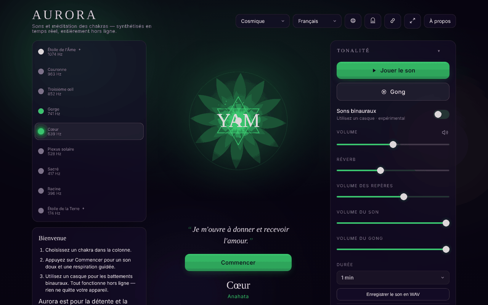

# Aurora

[English](README.md) · [Română](README.ro.md) · **Français** · [Italiano](README.it.md) · [Español](README.es.md) · [Português](README.pt.md) · [Deutsch](README.de.md) · [Magyar](README.hu.md)

**Version :** 1.3.5 · **Dernière mise à jour :** 2026-10-22

Langues de l'interface : **Română, English, Français, Italiano, Español, Português (PT), Deutsch, Magyar, Català, हिन्दी, العربية**

Chakra Sound & Meditation — sons, battements binauraux, guide de respiration et voyage à travers les chakras, dans un seul fichier HTML.

**Application en ligne :** https://chiuta.github.io/Aurora/

## Présentation

Aurora est un outil contemplatif de son et de méditation : vous choisissez un chakra, et l'application génère dans le navigateur un son (Web Audio API) à la fréquence associée, un mandala animé, en option des battements binauraux, un gong, une clochette à intervalle et un guide de respiration. L'application précise dans l'interface qu'elle est destinée à la détente et à la contemplation, et que les fréquences et les chakras proviennent de traditions spirituelles, et non de la médecine.

## Fonctionnalités

- Sélection de chakras avec des informations sur la fréquence, l'élément, le mantra, les pétales, le solfège (solfeggio), le « sense » et le ton.
- Génération de son, réglage du volume, réverbération, volumes séparés pour les indications, le son et le gong ; gong à la demande.
- Battements binauraux (casque recommandé), avec des préréglages Delta 2 Hz, Theta 6 Hz, Alpha 10 Hz et d'autres.
- Séance de durée réglable ; « Chakra journey » (voyage automatique à travers les chakras), options : équilibrage automatique, inclusion des chakras transpersonnels (9 chakras au lieu de 7), parcours descendant (de la couronne à la racine), clochette à intervalle.
- Guide de respiration avec des modèles au choix et des indications aux changements de phase.
- Affirmations affichées sous le mandala (facultatif), mode simple (masque les commandes avancées), mode zen/plein écran, écran maintenu allumé (Wake Lock, là où c'est pris en charge).
- Historique des séances récentes, préréglages, thème.
- Fenêtre « Gateway practices », fenêtre de raccourcis et tutoriel de respiration.
- Export / import / réinitialisation des réglages (fichier JSON).
- Le titre de l'onglet affiche « ▶ chakra · fréquence » pendant que le son est émis, et les métadonnées Media Session (titre, lecture/pause) sont définies localement pour les commandes du système, là où le navigateur les affiche.
- Impression : la feuille de style d'impression ne garde que le titre, l'affirmation et la fiche du chakra sélectionné, ainsi que les mentions de droits et d'avertissement, sans boutons.
- Interface en 11 langues : anglais, roumain, espagnol, français, italien, portugais, allemand, hongrois, catalan, hindi, arabe.

## Nouveautés (1.1.0)

- **Le son actuel en fichier WAV** (panneau « Tone », section « Audio file », masquée en mode simple) : vous choisissez la durée (1, 2, 3 ou 5 minutes) et l'application génère, avec `OfflineAudioContext`, le même son que celui qui est joué (mêmes oscillateurs, filtre et LFO), plus les battements binauraux s'ils sont actifs, avec la réverbération courante. Résultat : WAV stéréo, 16 bits, 32 kHz, normalisé à −1 dBFS, avec un fondu d'entrée de 1,5 s et un fondu de sortie d'environ 2,5 s ; nom de la forme `aurora-heart-639hz-binaural6.wav`. Il **n'inclut pas** le gong, la clochette à intervalle ni les indications de respiration. Les 5 minutes occupent environ 38 Mo et sont générées en mémoire (sur les vieux téléphones, cela peut échouer : l'application indique alors que le navigateur n'a pas pu générer le fichier). La réverbération utilise une impulsion aléatoire, donc deux fichiers générés successivement ne sont pas identiques bit à bit.
- **Code QR de la scène** (panneau « Session », « QR code of this scene ») : le code contient l'adresse publique (`https://chiuta.github.io/Aurora/`, ou celle de la page courante si elle est servie en HTTPS) et un hachage `#<chakra>&beat=<2|6|10>&breath=<modèle>`. À l'ouverture, le chakra, les battements binauraux (si le lien les demande) et le modèle de respiration sont appliqués ; les valeurs inconnues sont ignorées. Le lien peut aussi être copié. Le modèle « custom » n'est pas inclus dans le lien (il ne peut pas être représenté). Généré localement ; n'apparaît qu'avec le module QR.
- **Transparence** et **sauvegarde `.fff.json`** (appuyez sur la version dans la fenêtre « About ») : la fenêtre standard « sans frontières » avec le réseau (0 requête externe), les clés `aurora.*`, les autorisations et le SHA-256 ; la sauvegarde, chiffrable, couvre tous les réglages.

Les nouveaux textes sont dans les 11 langues de l'application (EN, RO, ES, FR, IT, PT, DE, HU, CA, HI, AR) ; les traductions autres que EN/RO sont automatiques et **non vérifiées par des locuteurs natifs**.

## Le kit « fff-kit »

Modules intégrés dans `index.html` : `core`, `label`, `bundle`, `qr`. La fenêtre « Transparence » du kit existe en 8 langues (RO, EN, FR, IT, ES, PT, HU, DE) ; lorsque l'application est en CA, HI ou AR, elle s'affiche en anglais. Sans le kit, l'application fonctionne de la même façon, mais sans le bouton QR.

## Tests

`node tests/fff-r8.test.mjs` (Playwright, réseau bloqué) : le fichier WAV est téléchargé et analysé spectralement dans le test (en-tête, durée, niveau, pic à la fréquence du chakra, L=220 Hz et R=220+beat Hz en binaural), la scène est encodée dans un QR, décodée en retour et rouverte dans une page propre, 9 langues (y compris l'arabe RTL), axe-core 0 violation sur les 3 thèmes et dans la fenêtre modale, 360 px, sans le kit.

## Mode d'emploi

1. Ouvrez la page et lisez la note initiale ; appuyez sur « Got it » (ou l'équivalent dans la langue choisie). Au premier lancement, un guide d'accueil apparaît (« Welcome » / « Begin »).
2. Choisissez la langue avec le bouton de langue de l'en-tête ou appuyez sur `L` pour passer à la suivante.
3. Sélectionnez un chakra (les flèches Haut/Bas changent de chakra).
4. Appuyez sur Espace pour démarrer/arrêter le son ; `G` frappe le gong.
5. Réglez le volume avec `+` / `-` ou depuis les commandes « Volume », « Reverb », « Tone volume », « Gong volume ».
6. Pour les battements binauraux, ouvrez la section « Binaural beats », choisissez « Beat » et utilisez un casque.
7. Pour la respiration, choisissez un modèle dans « Breathing » ; `B` passe au modèle suivant ; `?` ouvre le guide de respiration.
8. Dans « Session », réglez la « Duration » et, si vous le souhaitez, « Chakra journey ».
9. Échap ferme les fenêtres et quitte le mode zen.
10. Sauvegarde des données : « Export settings » télécharge `aurora-settings.json` ; « Import settings » le recharge ; « Reset to defaults » revient aux valeurs par défaut.

## Avertissement

Contenu contemplatif/de détente, non médical. Les chakras, les fréquences associées et les « sons guérisseurs » proviennent de traditions spirituelles et n'ont aucune validation scientifique ; il n'existe pas de preuves solides que certaines fréquences traitent des affections ou que les battements binauraux modifient de façon fiable l'état du cerveau. Ne remplace pas un avis médical. L'application affiche cet avertissement au premier lancement, dans « About » et dans le pied de page.

## Confidentialité et réseau

- **Stockage local :** `localStorage`, toutes les clés avec le préfixe `aurora.` (langue, thème, volumes, préférences de séance, préréglages, historique, indicateurs signalant que les notes ont été vues). Si le stockage est bloqué, l'application affiche un avertissement.
- **Réseau :** dans le code de l'application, il n'y a ni `fetch`, ni CDN, ni scripts ou ressources externes chargés automatiquement ; je n'ai trouvé aucune analyse d'audience. Le son est synthétisé localement.
- L'application contient une référence textuelle au Centrul AmaneSer (amaneser.ro) dans la note « About », sans chargement de ressources depuis ce site.

## Exécution locale / hors ligne

Téléchargez `index.html` et ouvrez-le dans un navigateur. Il n'a pas besoin d'internet pour fonctionner. Aucun serveur n'est nécessaire.

## Licence

MIT pour le code et la structure de l'application — voir le fichier `LICENSE`. Les éventuelles bibliothèques tierces incluses dans le fichier conservent leurs propres licences.

La déclaration figure aussi dans l'en-tête de `index.html` et dans le pied de page de l'application (RO + EN).

## Droits et attribution

- **Part de l'auteur :** le code, les textes et le design de l'application (Alexio — Alexandru-Ionuț Chiuță). Toute licence déclarée ultérieurement ne s'appliquera qu'à cette part.
- **Tiers / inspiration :** l'application s'inspire de la pratique des sons de détente (p. ex. le Centrul AmaneSer, amaneser.ro — aucune ressource n'est chargée depuis ce site) et mentionne la pratique « Gateway » (Institut Monroe). C'est un projet indépendant ; il n'implique aucune affiliation ni approbation de leur part et ne représente la position officielle d'aucune organisation.
- Les droits sur les matériaux et les noms de tiers appartiennent à leurs titulaires.
- **Rectification / retrait :** si vous êtes titulaire de droits ou une personne mentionnée et souhaitez une correction ou un retrait, écrivez à alexio@trom.tf ; nous répondons sous 7 jours.

*Droits et attribution :* le code, les textes et le design sont ceux de l'auteur ; toute licence déclarée ultérieurement ne s'applique qu'à cette part. Les inspirations/mentions (Centrul AmaneSer, Monroe Institute « Gateway ») n'impliquent ni affiliation ni approbation ; les droits sur les matériaux et les noms de tiers appartiennent à leurs titulaires. Titulaires de droits ou personnes mentionnées : écrivez à alexio@trom.tf pour une correction ou un retrait ; nous répondons sous 7 jours.

## Audit

Audit : 2026-10-10 — vérifié avec Playwright et axe-core ; CSP `default-src 'none'` confirmée ; pas de `fetch`/CDN. Tour 3 (2026-10-11) : déclaration de licence non déclarée + « Droits et attribution » dans l'application et le README. Corrigés : débordement horizontal sur mobile, noms accessibles pour les boutons de chakras ; ajout d'un avertissement permanent dans le pied de page. Tour 2 (2026-10-11) : meta description reformulée (sans « healing » : outil de détente, pas un traitement) ; `<html lang>` est déjà mis à jour au changement de langue.

## Historique / Journal des modifications

- 1.3.5 — 2026-10-22 : fff-kit 1.1.4 : cibles tactiles et taille de texte minimale ; cibles tactiles/texte corrigés
- 1.3.4 — 2026-10-22 : fff-kit 1.1.2 : PBKDF2 600 000 itérations, protection anti-clickjacking
- 1.3.3 — 2026-10-22: Les libellés des chakras, les indications des panneaux et les libellés de métadonnées utilisent un texte d'au moins 12 px; cibles tactiles d'au moins 24 px (cases à cocher, liens du pied de page).

- 1.3.2 — 2026-10-22: **correctif** : le nom accessible du sélecteur de chakras suit désormais la langue de l’interface.
### 1.3.1 — 2026-10-22
- L'allemand et le hongrois disposent désormais des noms, éléments, affirmations, descriptions et sens des chakras traduits (ils restaient en anglais).

### 19 octobre 2026 (v1.2.0)
- Bouton « Version ambiante dans CalmWaves » (nouvel onglet) : transmet le but (sommeil/détente/concentration selon le battement binaural, « méditation » sans binaural), la durée et la fréquence du chakra dans l'adresse de CalmWaves (`?v=…&from=aurora`). Simple lien, sans requête réseau.

### 14 octobre 2026 (v1.1.0)
- Nouveau : le son actuel en WAV, code QR de la scène (chakra + battements binauraux + respiration) et hachage étendu `#chakra&beat=…&breath=…`, fenêtre « Transparence » (fff-kit : core, label, bundle, qr) ; `tests/fff-r8.test.mjs`. CSP : hachage du script recalculé.

### 1.0.0 — 2026-10-12
- La version et la date de dernière mise à jour sont affichées dans l'application (fenêtre « À propos », dans les 11 langues).

### 11 octobre 2026 (tour 7)
- Amélioré : à la première ouverture (sans thème enregistré), l'application respecte les préférences du système : thème « light » si le système demande le schéma clair, « contrast » s'il demande un contraste accru (`prefers-color-scheme` / `prefers-contrast`) ; le choix manuel est prioritaire et conservé. Vérifié : 0 violation axe-core dans les thèmes light et contrast.
- Vérifié, pas un défaut : le bouton « Begin » se masque pendant que le son est émis (comportement voulu ; Lecture/Pause reste visible) et réapparaît à la pause.

### 11 octobre 2026 (tour 6)
- Sécurité : CSP `script-src` sur le hachage SHA-256 du script unique, sans `'unsafe-inline'` pour les scripts (les styles en ligne restent autorisés).
- Ajouté : le titre de l'onglet et la Media Session reflètent le chakra et l'état de la lecture ; feuille de style d'impression.

### 11 octobre 2026
- Corrigé : le contenu est désormais encadré par des repères (`<main>`, `<footer>`), de sorte que la règle axe-core « region » passe ; 0 violation à 1280 et 360 px.
- Note (inchangée) : les associations chakra–fréquence/élément/« sense » proviennent de traditions spirituelles, et non de sources scientifiques, comme l'indique la note affichée dans l'application ; le son n'a pas pu être évalué à l'oreille dans les tests automatisés.

## Auteur

Alexio — Alexandru-Ionuț Chiuță, contact : alexio@trom.tf

## Résumé

Aurora est un outil de son et de méditation chakra en un seul fichier : sons synthétisés (Web Audio), battements binauraux, gong, guide de respiration, voyage automatique à travers les chakras, historique des séances, export/import des réglages et une interface en 11 langues. Les préférences sont conservées dans localStorage sous le préfixe `aurora.` ; l'application ne fait aucune requête réseau. Elle est destinée à la détente, pas à la médecine.

Nouveautés de la 1.1.0 : enregistrer le son actuel en WAV stéréo 16 bits (1 à 5 min, généré hors ligne dans le navigateur ; sans gong, clochettes ni indications de respiration), un code QR/lien pour la scène actuelle (chakra + battement binaural + modèle de respiration) et la boîte de dialogue « Transparence ». Les traductions autres que EN/RO des nouvelles chaînes sont automatiques et non vérifiées par des locuteurs natifs.
