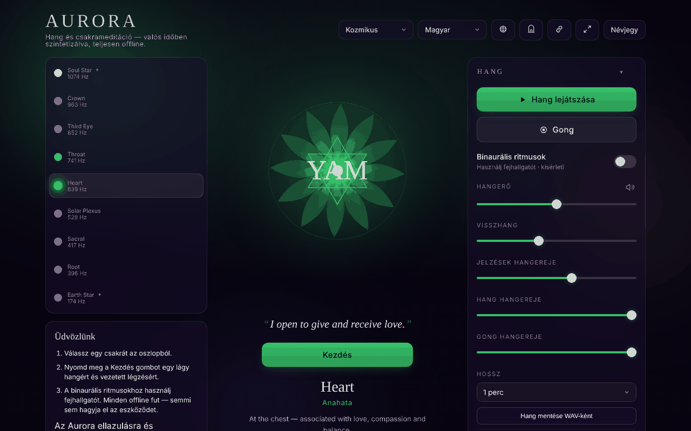

# Aurora

[English](README.md) · [Română](README.ro.md) · [Français](README.fr.md) · [Italiano](README.it.md) · [Español](README.es.md) · [Português](README.pt.md) · [Deutsch](README.de.md) · **Magyar**

**Verzió:** 1.3.0 · **Utolsó frissítés:** 2026-10-19

A felület nyelvei: **Română, English, Français, Italiano, Español, Português (PT), Deutsch, Magyar, Català, हिन्दी, العربية**

Chakra Sound & Meditation — hangok, binaurális ütemek, légzésvezető és utazás a csakrákon át, egyetlen HTML-fájlban.

**Online alkalmazás:** https://chiuta.github.io/Aurora/

## Mi ez

Az Aurora egy szemlélődő hang- és meditációs eszköz: kiválasztasz egy csakrát, az alkalmazás pedig a böngészőben előállít egy hangot (Web Audio API) a hozzá tartozó frekvenciával, egy animált mandalát, opcionálisan binaurális ütemeket, gongot, időközönként megszólaló csengőt és légzésvezetőt. Az alkalmazás a felületen jelzi, hogy relaxációra és szemlélődésre szolgál, a frekvenciák és a csakrák pedig spirituális hagyományokból származnak, nem az orvostudományból.

## Funkciók

- Csakraválasztás a frekvenciára, elemre, mantrára, szirmokra, solfeggióra, „sense”-re és hangra vonatkozó információkkal.
- Hangelőállítás, hangerő-szabályozás, utózengés, külön hangerők az útmutatásokhoz, a hanghoz és a gonghoz; gong kérésre.
- Binaurális ütemek (fejhallgató ajánlott), Delta 2 Hz, Theta 6 Hz, Alpha 10 Hz és más előbeállításokkal.
- Beállítható időtartamú alkalom; „Chakra journey” (automatikus utazás a csakrákon át), beállítások: automatikus kiegyensúlyozás, a transzperszonális csakrák bevonása (7 helyett 9 csakra), lefelé haladó bejárás (a korona csakrától a gyökérig), időközönként megszólaló csengő.
- Légzésvezető választható mintákkal és útmutatásokkal a fázisváltásoknál.
- A mandala alatt megjelenített megerősítések (opcionális), egyszerű mód (elrejti a speciális vezérlőket), zen/teljes képernyős mód, bekapcsolva maradó képernyő (Wake Lock, ahol támogatott).
- A legutóbbi alkalmak előzményei, előbeállítások, téma.
- „Gateway practices” ablak, billentyűparancs-ablak és légzési oktató.
- A beállítások exportálása / importálása / visszaállítása (JSON-fájl).
- A lap címe „▶ csakra · frekvencia” szöveget mutat, amíg a hang szól, a Media Session metaadatai (cím, lejátszás/szünet) pedig helyben vannak beállítva a rendszervezérlőkhöz, ahol a böngésző megjeleníti őket.
- Nyomtatás: a nyomtatási stíluslap csak a címet, a megerősítést és a kiválasztott csakra lapját tartja meg, valamint a jogi és figyelmeztető megjegyzéseket, gombok nélkül.
- Felület 11 nyelven: angol, román, spanyol, francia, olasz, portugál, német, magyar, katalán, hindi, arab.

## Újdonságok (1.1.0)

- **Az aktuális hang WAV-fájlként** („Tone” panel, „Audio file” szakasz, egyszerű módban rejtve): kiválasztod az időtartamot (1, 2, 3 vagy 5 perc), és az alkalmazás az `OfflineAudioContext` segítségével előállítja ugyanazt a hangot, mint amelyik szól (ugyanazok az oszcillátorok, szűrő és LFO-k), plusz a binaurális ütemeket, ha aktívak, az aktuális utózengéssel. Eredmény: sztereó WAV, 16 bites, 32 kHz, −1 dBFS-re normalizálva, 1,5 s-os felúsztatással és ~2,5 s-os lehalkulással; a fájlnév alakja `aurora-heart-639hz-binaural6.wav`. **Nem tartalmazza** a gongot, az időközönként megszólaló csengőt és a légzési útmutatásokat. Az 5 perc ~38 MB-ot foglal, és a memóriában készül el (régi telefonokon meghiúsulhat: ilyenkor az alkalmazás jelzi, hogy a böngésző nem tudta előállítani a fájlt). Az utózengés véletlenszerű impulzust használ, ezért két egymás után előállított fájl nem azonos bitre pontosan.
- **A jelenet QR-kódja** („Session” panel, „QR code of this scene”): a kód tartalmazza a nyilvános címet (`https://chiuta.github.io/Aurora/`, vagy az aktuális oldalét, ha HTTPS-en szolgálják ki) és egy `#<csakra>&beat=<2|6|10>&breath=<minta>` hash-t. Megnyitáskor érvénybe lép a csakra, a binaurális ütemek (ha a hivatkozás kéri őket) és a légzési minta; az ismeretlen értékeket figyelmen kívül hagyja. A hivatkozás másolható is. A „custom” minta nem része a hivatkozásnak (nem ábrázolható). Helyben előállított; csak a QR-modullal jelenik meg.
- **Átláthatóság** és **`.fff.json` biztonsági mentés** (nyomd meg a verziót a „About” ablakban): a szokásos „határok nélküli” ablak a hálózattal (0 külső kérés), az `aurora.*` kulcsokkal, az engedélyekkel és az SHA-256 értékkel; a titkosítható biztonsági mentés az összes beállításra kiterjed.

Az új szövegek az alkalmazás 11 nyelvén megvannak (EN, RO, ES, FR, IT, PT, DE, HU, CA, HI, AR); az EN/RO-tól eltérő fordítások gépiek, és **anyanyelvi beszélők nem ellenőrizték őket**.

## Az „fff-kit” készlet

Az `index.html` fájlba beillesztett modulok: `core`, `label`, `bundle`, `qr`. A készlet „Átláthatóság” ablaka 8 nyelven érhető el (RO, EN, FR, IT, ES, PT, HU, DE); ha az alkalmazás CA, HI vagy AR nyelven fut, angolul jelenik meg. A készlet nélkül az alkalmazás ugyanúgy működik, de a QR-gomb nélkül.

## Tesztek

`node tests/fff-r8.test.mjs` (Playwright, letiltott hálózat): a WAV-fájlt a teszt letölti és spektrálisan elemzi (fejléc, időtartam, szint, csúcs a csakra frekvenciáján, L=220 Hz és R=220+ütem Hz binaurális esetben), a jelenetet QR-kódba kódolja, visszafejti, és tiszta oldalon újra megnyitja, 9 nyelv (az RTL arabbal együtt), axe-core 0 szabálysértés a 3 témán és a modális ablakban, 360 px, a készlet nélkül.

## Használati útmutató

1. Nyisd meg az oldalt, és olvasd el a kezdő megjegyzést; nyomd meg a „Got it” gombot (vagy a megfelelőjét a kiválasztott nyelven). Az első indításkor üdvözlő útmutató jelenik meg („Welcome” / „Begin”).
2. Válaszd ki a nyelvet a fejlécben lévő nyelvgombbal, vagy nyomd meg az `L` billentyűt a következőre váltáshoz.
3. Válassz egy csakrát (a Fel/Le nyilak váltják a csakrát).
4. A Szóköz indítja/leállítja a hangot; a `G` megüti a gongot.
5. Szabályozd a hangerőt a `+` / `-` billentyűkkel vagy a „Volume”, „Reverb”, „Tone volume”, „Gong volume” vezérlőkkel.
6. Binaurális ütemekhez nyisd meg a „Binaural beats” szakaszt, válaszd ki a „Beat” értéket, és használj fejhallgatót.
7. Légzéshez válassz egy mintát a „Breathing” alatt; a `B` a következő mintára vált; a `?` megnyitja a légzési útmutatót.
8. A „Session” alatt állítsd be a „Duration” értéket és, ha szeretnéd, a „Chakra journey” funkciót.
9. Az Escape bezárja az ablakokat, és kilép a zen módból.
10. Adatmentés: az „Export settings” letölti az `aurora-settings.json` fájlt; az „Import settings” újra betölti; a „Reset to defaults” visszaállítja az alapértelmezett értékeket.

## Figyelmeztetés

Szemlélődő/relaxációs tartalom, nem orvosi. A csakrák, a hozzájuk rendelt frekvenciák és a „gyógyító hangok” spirituális hagyományokból származnak, és nincs tudományos igazolásuk; nincs szilárd bizonyíték arra, hogy bizonyos frekvenciák betegségeket kezelnek, vagy hogy a binaurális ütemek megbízhatóan megváltoztatják az agy állapotát. Nem helyettesíti az orvosi tanácsot. Az alkalmazás ezt a figyelmeztetést az első indításkor, a „About” ablakban és az oldal láblécében jeleníti meg.

## Adatvédelem és hálózat

- **Helyi tárolás:** `localStorage`, minden kulcs `aurora.` előtaggal (nyelv, téma, hangerők, alkalmi beállítások, előbeállítások, előzmények, jelzők arról, hogy a megjegyzéseket már látták). Ha a tárolás le van tiltva, az alkalmazás figyelmeztetést jelenít meg.
- **Hálózat:** az alkalmazás kódjában nincs `fetch`, CDN, automatikusan betöltött szkript vagy külső erőforrás; elemzést nem találtam. A hang helyben szintetizálódik.
- Az alkalmazás a „About” megjegyzésben szöveges hivatkozást tartalmaz a Centrul AmaneSerre (amaneser.ro), onnan erőforrások betöltése nélkül.

## Helyi futtatás / offline

Töltsd le az `index.html` fájlt, és nyisd meg egy böngészőben. A működéséhez nincs szükség internetre. Szerver nem szükséges.

## Licenc

MIT az alkalmazás kódjára és szerkezetére — lásd a `LICENSE` fájlt. A fájlban esetlegesen szereplő harmadik féltől származó könyvtárak megtartják saját licencüket.

A nyilatkozat az `index.html` fejlécében és az alkalmazás láblécében is megjelenik (RO + EN).

## Jogok és forrásmegjelölés

- **A szerző része:** az alkalmazás kódja, szövegei és dizájnja (Alexio — Alexandru-Ionuț Chiuță). Bármely később megadott licenc csak erre a részre vonatkozik.
- **Harmadik felek / inspiráció:** az alkalmazást a relaxációs hangok gyakorlata ihlette (pl. a Centrul AmaneSer, amaneser.ro — onnan erőforrások nem töltődnek be), és megemlíti a „Gateway” gyakorlatot (Monroe Intézet). Független projekt; nem jelent kapcsolatot vagy jóváhagyást a részükről, és egyetlen szervezet hivatalos álláspontját sem képviseli.
- A harmadik felek anyagaira és neveire vonatkozó jogok tulajdonosaikat illetik.
- **Helyesbítés / visszavonás:** ha jogtulajdonos vagy említett személy vagy, és helyesbítést vagy visszavonást kérsz, írj az alexio@trom.tf címre; 7 napon belül válaszolunk.

*Jogok és forrásmegjelölés:* a kód, a szövegek és a dizájn a szerzőé; bármely később megadott licenc csak erre a részre vonatkozik. Az inspirációk/említések (Centrul AmaneSer, Monroe Institute „Gateway”) nem jelentenek kapcsolatot vagy jóváhagyást; a harmadik felek anyagaira és neveire vonatkozó jogok tulajdonosaikat illetik. Jogtulajdonosok vagy említett személyek: írjanak az alexio@trom.tf címre helyesbítés vagy eltávolítás céljából; 7 napon belül válaszolunk.

## Audit

Audit: 2026-10-10 — Playwrighttal és axe-core-ral ellenőrizve; a CSP `default-src 'none'` megerősítve; nincs `fetch`/CDN. 3. kör (2026-10-11): a meg nem adott licencről szóló nyilatkozat + „Jogok és forrásmegjelölés” az alkalmazásban és a README-ben. Javítva: vízszintes túlcsordulás mobilon, elérhető nevek a csakragombokhoz; állandó figyelmeztetés a láblécben. 2. kör (2026-10-11): a meta description átfogalmazva („healing” nélkül: relaxációs eszköz, nem kezelés); a `<html lang>` már frissül a nyelv váltásakor.

## Előzmények / Változásnapló

### 2026. október 19. (v1.2.0)
- „Ambient változat a CalmWavesben” gomb (új lap): a célt (alvás/relaxáció/koncentráció a binaurális ütem szerint, binaurális nélkül „meditáció”), az időtartamot és a csakra frekvenciáját átadja a CalmWaves címében (`?v=…&from=aurora`). Csak hivatkozás, hálózati kérések nélkül.

### 2026. október 14. (v1.1.0)
- Új: az aktuális hang WAV-ként, a jelenet QR-kódja (csakra + binaurális ütemek + légzés) és a kibővített `#csakra&beat=…&breath=…` hash, „Átláthatóság” ablak (fff-kit: core, label, bundle, qr); `tests/fff-r8.test.mjs`. CSP: a szkript hash-e újraszámolva.

### 1.0.0 — 2026-10-12
- A verzió és az utolsó frissítés dátuma megjelenik az alkalmazásban („Névjegy” ablak, a 11 nyelven).

### 2026. október 11. (7. kör)
- Továbbfejlesztve: az első megnyitáskor (mentett téma nélkül) az alkalmazás tiszteletben tartja a rendszerbeállításokat: „light” téma, ha a rendszer a világos sémát kéri, „contrast”, ha növelt kontrasztot kér (`prefers-color-scheme` / `prefers-contrast`); a kézi választás elsőbbséget élvez, és megmarad. Ellenőrizve: 0 axe-core szabálysértés a light és a contrast témában.
- Ellenőrizve, nem hiba: a „Begin” gomb elrejtőzik, amíg a hang szól (szándékos viselkedés; a Lejátszás/Szünet látható marad), és szüneteltetéskor újra megjelenik.

### 2026. október 11. (6. kör)
- Biztonság: CSP `script-src` az egyetlen szkript SHA-256 hash-ére, szkriptekhez `'unsafe-inline'` nélkül (a beágyazott stílusok továbbra is engedélyezettek).
- Hozzáadva: a lap címe és a Media Session tükrözi a csakrát és a lejátszás állapotát; nyomtatási stíluslap.

### 2026. október 11.
- Javítva: a tartalom mostantól támpontokba (`<main>`, `<footer>`) van foglalva, így az axe-core „region” szabálya teljesül; 0 szabálysértés 1280 és 360 px-nél.
- Megjegyzés (változatlan): a csakra–frekvencia/elem/„sense” társítások spirituális hagyományokból származnak, nem tudományos forrásokból, ahogy az alkalmazásban megjelenő megjegyzés is mondja; a hangot az automatikus tesztekben nem lehetett hallás alapján értékelni.

## Szerző

Alexio — Alexandru-Ionuț Chiuță, kapcsolat: alexio@trom.tf

## Összefoglaló

Az Aurora egy egyfájlos csakra-hang- és meditációs eszköz: szintetizált hangok (Web Audio), binaurális ütemek, gong, légzésvezető, automatikus utazás a csakrákon át, alkalmi előzmények, a beállítások exportálása/importálása és 11 nyelvű felület. A beállítások a localStorage-ban tárolódnak az `aurora.` előtaggal; az alkalmazás nem küld hálózati kéréseket. Relaxációra szolgál, nem orvosi célra.

Újdonság az 1.1.0-ban: az aktuális hang mentése 16 bites sztereó WAV-ként (1–5 perc, offline, a böngészőben előállítva; gong, csengők és légzési útmutatások nélkül), QR-kód/hivatkozás az aktuális jelenethez (csakra + binaurális ütem + légzési minta) és az „Átláthatóság” párbeszédablak. Az új szövegek EN/RO-tól eltérő fordításai gépiek, és anyanyelvi beszélők nem ellenőrizték őket.
