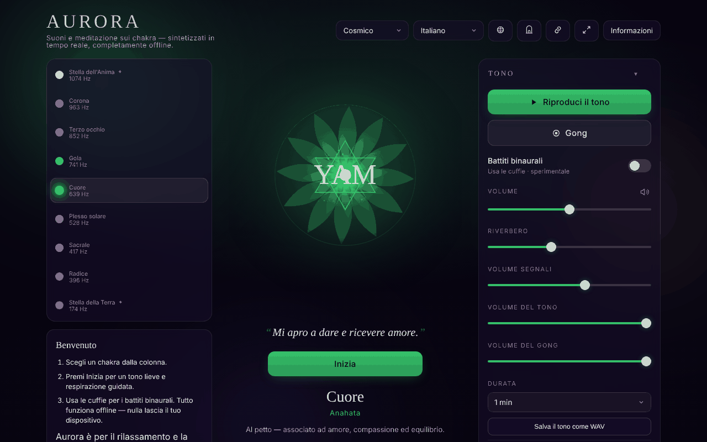

# Aurora

[English](README.md) · [Română](README.ro.md) · [Français](README.fr.md) · **Italiano** · [Español](README.es.md) · [Português](README.pt.md) · [Deutsch](README.de.md) · [Magyar](README.hu.md)

**Versione:** 1.3.6 · **Ultimo aggiornamento:** 2026-10-23

Lingue dell'interfaccia: **Română, English, Français, Italiano, Español, Português (PT), Deutsch, Magyar, Català, हिन्दी, العربية**

Chakra Sound & Meditation — toni, battiti binaurali, guida alla respirazione e viaggio attraverso i chakra, in un unico file HTML.

**App online:** https://chiuta.github.io/Aurora/

## Che cos'è

Aurora è uno strumento contemplativo di suono e meditazione: scegli un chakra, e l'applicazione genera nel browser un tono (Web Audio API) con la frequenza associata, un mandala animato, facoltativamente battiti binaurali, un gong, una campanella a intervalli e una guida alla respirazione. L'applicazione precisa nell'interfaccia che è pensata per il rilassamento e la contemplazione, e che le frequenze e i chakra provengono da tradizioni spirituali, non dalla medicina.

## Funzioni

- Selezione dei chakra con informazioni su frequenza, elemento, mantra, petali, solfeggio, «sense» e tono.
- Generazione del tono, regolazione del volume, riverbero, volumi separati per le indicazioni, il tono e il gong; gong a richiesta.
- Battiti binaurali (consigliate le cuffie), con preset Delta 2 Hz, Theta 6 Hz, Alpha 10 Hz e altri.
- Sessione con durata impostabile; «Chakra journey» (viaggio automatico attraverso i chakra), opzioni: bilanciamento automatico, inclusione dei chakra transpersonali (9 chakra invece di 7), percorso discendente (dalla corona alla radice), campanella a intervalli.
- Guida alla respirazione con schemi selezionabili e indicazioni ai cambi di fase.
- Affermazioni mostrate sotto il mandala (facoltativo), modalità semplice (nasconde i controlli avanzati), modalità zen/schermo intero, schermo che resta acceso (Wake Lock, dove supportato).
- Cronologia delle sessioni recenti, preset, tema.
- Finestra «Gateway practices», finestra delle scorciatoie e tutorial di respirazione.
- Esportazione / importazione / ripristino delle impostazioni (file JSON).
- Il titolo della scheda mostra «▶ chakra · frequenza» finché il tono suona, e i metadati Media Session (titolo, play/pausa) sono impostati localmente per i controlli di sistema, dove il browser li mostra.
- Stampa: il foglio di stile di stampa conserva solo il titolo, l'affermazione e la scheda del chakra selezionato, più le note sui diritti e l'avvertenza, senza pulsanti.
- Interfaccia in 11 lingue: inglese, rumeno, spagnolo, francese, italiano, portoghese, tedesco, ungherese, catalano, hindi, arabo.

## Novità (1.1.0)

- 1.3.4 — 2026-10-22: fff-kit 1.1.2: PBKDF2 600.000 iterazioni, protezione anti-clickjacking
- **Il tono corrente come file WAV** (pannello «Tone», sezione «Audio file», nascosta nella modalità semplice): scegli la durata (1, 2, 3 o 5 minuti) e l'applicazione genera, con `OfflineAudioContext`, lo stesso tono di quello riprodotto (stessi oscillatori, filtro e LFO), più i battiti binaurali se attivi, con il riverbero corrente. Risultato: WAV stereo, 16 bit, 32 kHz, normalizzato a −1 dBFS, con dissolvenza in entrata di 1,5 s e in uscita di ~2,5 s; nome del tipo `aurora-heart-639hz-binaural6.wav`. **Non include** il gong, la campanella a intervalli e le indicazioni di respirazione. I 5 minuti occupano ~38 MB e vengono generati in memoria (sui telefoni vecchi può fallire: l'applicazione dice allora che il browser non è riuscito a generare il file). Il riverbero usa un impulso casuale, quindi due file generati in successione non sono identici bit a bit.
- **Codice QR della scena** (pannello «Session», «QR code of this scene»): il codice contiene l'indirizzo pubblico (`https://chiuta.github.io/Aurora/`, o quello della pagina corrente se servita su HTTPS) e un hash `#<chakra>&beat=<2|6|10>&breath=<schema>`. All'apertura vengono applicati il chakra, i battiti binaurali (se il link li richiede) e lo schema di respirazione; i valori sconosciuti vengono ignorati. Si può copiare anche il link. Lo schema «custom» non è incluso nel link (non può essere rappresentato). Generato localmente; compare solo con il modulo QR.
- **Trasparenza** e **copia di riserva `.fff.json`** (premi la versione nella finestra «About»): la finestra standard «senza frontiere» con la rete (0 richieste esterne), le chiavi `aurora.*`, i permessi e lo SHA-256; la copia di riserva, cifrabile, copre tutte le impostazioni.

I nuovi testi sono nelle 11 lingue dell'applicazione (EN, RO, ES, FR, IT, PT, DE, HU, CA, HI, AR); le traduzioni diverse da EN/RO sono automatiche e **non verificate da madrelingua**.

## Il kit «fff-kit»

Moduli incollati in `index.html`: `core`, `label`, `bundle`, `qr`. La finestra «Trasparenza» del kit ha 8 lingue (RO, EN, FR, IT, ES, PT, HU, DE); quando l'applicazione è in CA, HI o AR, compare in inglese. Senza il kit, l'applicazione funziona allo stesso modo, ma senza il pulsante QR.

## Test

`node tests/fff-r8.test.mjs` (Playwright, rete bloccata): il file WAV viene scaricato e analizzato spettralmente nel test (intestazione, durata, livello, picco alla frequenza del chakra, L=220 Hz e R=220+beat Hz in binaurale), la scena viene codificata in QR, decodificata di nuovo e riaperta in una pagina pulita, 9 lingue (compreso l'arabo RTL), axe-core 0 violazioni sui 3 temi e nella finestra modale, 360 px, senza il kit.

## Guida all'uso

1. Apri la pagina e leggi la nota iniziale; premi «Got it» (o l'equivalente nella lingua scelta). Al primo avvio compare una guida di benvenuto («Welcome» / «Begin»).
2. Scegli la lingua con il pulsante della lingua nell'intestazione o premi `L` per passare alla successiva.
3. Seleziona un chakra (le frecce Su/Giù cambiano chakra).
4. Premi Spazio per avviare/fermare il tono; `G` colpisce il gong.
5. Regola il volume con `+` / `-` o dai controlli «Volume», «Reverb», «Tone volume», «Gong volume».
6. Per i battiti binaurali, apri la sezione «Binaural beats», scegli «Beat» e usa le cuffie.
7. Per la respirazione, scegli uno schema da «Breathing»; `B` passa allo schema successivo; `?` apre la guida alla respirazione.
8. In «Session» imposta la «Duration» e, se vuoi, «Chakra journey».
9. Escape chiude le finestre ed esce dalla modalità zen.
10. Salvataggio dei dati: «Export settings» scarica `aurora-settings.json`; «Import settings» lo ricarica; «Reset to defaults» ripristina i valori predefiniti.

## Avvertenza

Contenuto contemplativo/di rilassamento, non medico. I chakra, le frequenze associate e i «suoni guaritori» provengono da tradizioni spirituali e non hanno validazione scientifica; non esistono prove solide che certe frequenze curino disturbi o che i battiti binaurali modifichino in modo affidabile lo stato del cervello. Non sostituisce il parere medico. L'applicazione mostra questa avvertenza al primo avvio, in «About» e nel piè di pagina.

## Riservatezza e rete

- **Archiviazione locale:** `localStorage`, tutte le chiavi con il prefisso `aurora.` (lingua, tema, volumi, preferenze di sessione, preset, cronologia, indicatori che le note sono state viste). Se l'archiviazione è bloccata, l'applicazione mostra un avviso.
- **Rete:** nel codice dell'applicazione non ci sono `fetch`, CDN, script o risorse esterne caricate automaticamente; non ho trovato analytics. Il suono è sintetizzato localmente.
- L'applicazione contiene un riferimento testuale al Centrul AmaneSer (amaneser.ro) nella nota «About», senza caricamento di risorse da lì.

## Esecuzione locale / offline

Scarica `index.html` e aprilo in un browser. Non richiede internet per funzionare. Non serve alcun server.

## Licenza

MIT per il codice e la struttura dell'applicazione — vedi il file `LICENSE`. Le eventuali librerie di terze parti incluse nel file mantengono le proprie licenze.

La dichiarazione compare anche nell'intestazione di `index.html` e nel piè di pagina dell'applicazione (RO + EN).

## Diritti e attribuzione

- **Parte dell'autore:** il codice, i testi e il design dell'applicazione (Alexio — Alexandru-Ionuț Chiuță). Qualsiasi licenza dichiarata in seguito si applicherà solo a questa parte.
- **Terzi / ispirazione:** l'applicazione è ispirata alla pratica dei suoni per il rilassamento (ad es. il Centrul AmaneSer, amaneser.ro — da lì non si caricano risorse) e menziona la pratica «Gateway» (Monroe Institute). È un progetto indipendente; non implica affiliazione né approvazione da parte loro e non rappresenta la posizione ufficiale di alcuna organizzazione.
- I diritti sui materiali e sui nomi di terzi appartengono ai rispettivi titolari.
- **Rettifica / ritiro:** se sei titolare di diritti o una persona menzionata e desideri una correzione o un ritiro, scrivi a alexio@trom.tf; rispondiamo entro 7 giorni.

*Diritti e attribuzione:* il codice, i testi e il design sono dell'autore; qualsiasi licenza dichiarata in seguito si applica solo a tale parte. Ispirazioni/menzioni (Centrul AmaneSer, Monroe Institute «Gateway») non implicano affiliazione né approvazione; i diritti sui materiali e sui nomi di terzi appartengono ai rispettivi titolari. Titolari di diritti o persone menzionate: scrivete a alexio@trom.tf per correzione o rimozione; rispondiamo entro 7 giorni.

## Audit

Audit: 2026-10-10 — verificato con Playwright e axe-core; CSP `default-src 'none'` confermata; nessun `fetch`/CDN. Giro 3 (2026-10-11): dichiarazione di licenza non dichiarata + «Diritti e attribuzione» nell'applicazione e nel README. Corretti: overflow orizzontale su mobile, nomi accessibili per i pulsanti dei chakra; aggiunta un'avvertenza permanente nel piè di pagina. Giro 2 (2026-10-11): meta description riformulata (senza «healing»: strumento di rilassamento, non un trattamento); `<html lang>` si aggiorna già al cambio di lingua.

## Cronologia / Changelog

- 1.3.5 — 2026-10-22: fff-kit 1.1.4: target touch e dimensione minima del testo; target touch/testo corretti
- 1.3.3 — 2026-10-22: Le etichette dei chakra, i suggerimenti dei pannelli e le etichette dei metadati usano testo di almeno 12 px; aree di tocco di almeno 24 px (caselle di spunta, link a piè di pagina).

- 1.3.2 — 2026-10-22: **correzione**: il nome accessibile del selettore dei chakra segue ora la lingua dell’interfaccia.
### 1.3.1 — 2026-10-22
- Tedesco e ungherese hanno ora nomi, elementi, affermazioni, descrizioni e sensi dei chakra tradotti (erano rimasti in inglese).

### 19 ottobre 2026 (v1.2.0)
- Pulsante «Versione ambientale in CalmWaves» (nuova scheda): passa lo scopo (sonno/rilassamento/concentrazione in base al battito binaurale, «meditazione» senza binaurale), la durata e la frequenza del chakra nell'indirizzo di CalmWaves (`?v=…&from=aurora`). Solo link, senza richieste di rete.

### 14 ottobre 2026 (v1.1.0)
- Novità: il tono corrente come WAV, codice QR della scena (chakra + battiti binaurali + respirazione) e hash esteso `#chakra&beat=…&breath=…`, finestra «Trasparenza» (fff-kit: core, label, bundle, qr); `tests/fff-r8.test.mjs`. CSP: hash dello script ricalcolato.

### 1.0.0 — 2026-10-12
- La versione e la data dell'ultimo aggiornamento sono mostrate nell'applicazione (finestra «Informazioni», nelle 11 lingue).

### 11 ottobre 2026 (giro 7)
- Migliorato: alla prima apertura (senza tema salvato) l'applicazione rispetta le preferenze di sistema: tema «light» se il sistema richiede lo schema chiaro, «contrast» se richiede un contrasto maggiore (`prefers-color-scheme` / `prefers-contrast`); la scelta manuale ha la precedenza e viene conservata. Verificato: 0 violazioni axe-core nei temi light e contrast.
- Verificato, non è un difetto: il pulsante «Begin» si nasconde finché il tono suona (comportamento voluto; Play/Pausa resta visibile) e riappare in pausa.

### 11 ottobre 2026 (giro 6)
- Sicurezza: CSP `script-src` sull'hash SHA-256 dell'unico script, senza `'unsafe-inline'` per gli script (gli stili inline restano consentiti).
- Aggiunto: il titolo della scheda e la Media Session riflettono il chakra e lo stato della riproduzione; foglio di stile di stampa.

### 11 ottobre 2026
- Corretto: il contenuto è ora inquadrato in landmark (`<main>`, `<footer>`), in modo che la regola axe-core «region» passi; 0 violazioni a 1280 e 360 px.
- Nota (invariata): le associazioni chakra–frequenza/elemento/«sense» provengono da tradizioni spirituali, non da fonti scientifiche, come dice la nota mostrata nell'applicazione; il suono non ha potuto essere valutato all'ascolto nei test automatici.

## Autore

Alexio — Alexandru-Ionuț Chiuță, contatto: alexio@trom.tf

## Riepilogo

Aurora è uno strumento di suono e meditazione sui chakra in un unico file: toni sintetizzati (Web Audio), battiti binaurali, gong, guida alla respirazione, viaggio automatico attraverso i chakra, cronologia delle sessioni, esportazione/importazione delle impostazioni e un'interfaccia in 11 lingue. Le preferenze sono conservate in localStorage con il prefisso `aurora.`; l'app non effettua richieste di rete. È pensata per il rilassamento, non per la medicina.

Novità della 1.1.0: salvare il tono corrente come WAV stereo a 16 bit (1–5 min, generato offline nel browser; senza gong, campanelle né indicazioni di respirazione), un codice QR/link per la scena corrente (chakra + battito binaurale + schema di respirazione) e la finestra «Trasparenza». Le traduzioni diverse da EN/RO delle nuove stringhe sono automatiche e non verificate da madrelingua.
