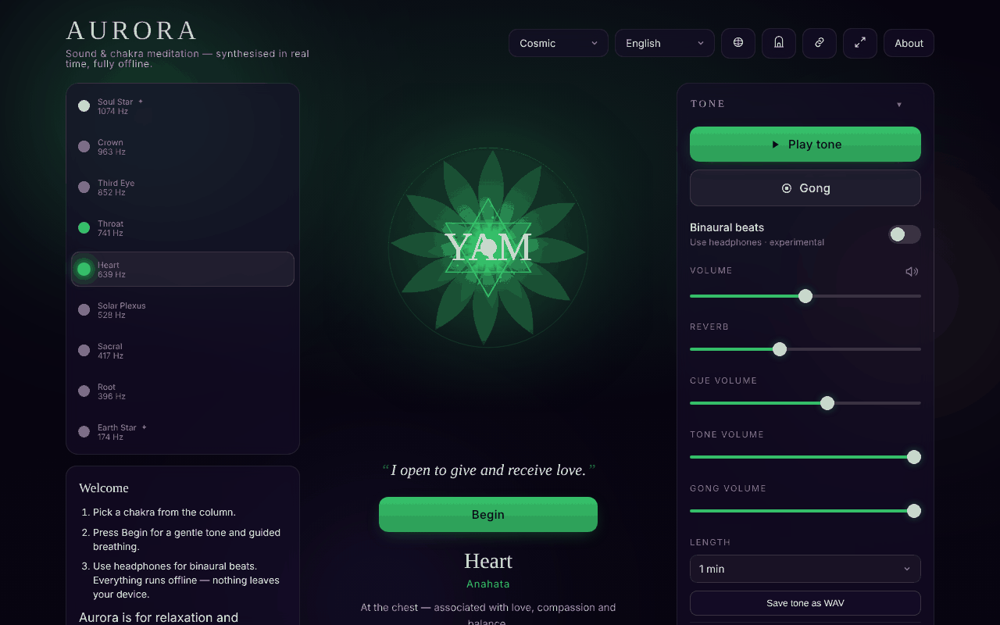

# Aurora

**English** · [Română](README.ro.md) · [Français](README.fr.md) · [Italiano](README.it.md) · [Español](README.es.md) · [Português](README.pt.md) · [Deutsch](README.de.md) · [Magyar](README.hu.md)

**Version:** 1.3.7 · **Last updated:** 2026-10-23

Interface languages: **Română, English, Français, Italiano, Español, Português (PT), Deutsch, Magyar, Català, हिन्दी, العربية**

Chakra Sound & Meditation — tones, binaural beats, a breathing guide and a journey through the chakras, in a single HTML file.

**Live app:** https://chiuta.github.io/Aurora/

## What it is

Aurora is a contemplative sound and meditation tool: you choose a chakra, and the application generates in the browser a tone (Web Audio API) with the associated frequency, an animated mandala, optionally binaural beats, a gong, an interval bell and a breathing guide. The application states in the interface that it is for relaxation and contemplation, and that the frequencies and chakras come from spiritual traditions, not from medicine.

## Features

- Chakra selection with information about frequency, element, mantra, petals, solfeggio, "sense" and tone.
- Tone generation, volume control, reverb, separate volumes for cues, tone and gong; gong on demand.
- Binaural beats (headphones recommended), with presets Delta 2 Hz, Theta 6 Hz, Alpha 10 Hz and others.
- Session with an adjustable duration; "Chakra journey" (an automatic journey through the chakras), options: automatic balancing, including the transpersonal chakras (9 chakras instead of 7), descending order (from crown to root), interval bell.
- Breathing guide with selectable patterns and cues at phase changes.
- Affirmations displayed below the mandala (optional), simple mode (hides the advanced controls), zen/full-screen mode, screen that stays on (Wake Lock, where supported).
- History of recent sessions, presets, theme.
- "Gateway practices" window, a shortcuts window and a breathing tutorial.
- Export / import / reset of the settings (JSON file).
- The tab title shows "▶ chakra · frequency" while the tone is playing, and the Media Session metadata (title, play/pause) is set locally for the system controls, where the browser displays them.
- Printing: the print stylesheet keeps only the title, the affirmation and the sheet of the selected chakra, plus the rights and warning notes, without buttons.
- Interface in 11 languages: English, Romanian, Spanish, French, Italian, Portuguese, German, Hungarian, Catalan, Hindi, Arabic.

## New features (1.1.0)

- **The current tone as a WAV file** ("Tone" panel, "Audio file" section, hidden in simple mode): you choose the duration (1, 2, 3 or 5 minutes) and the application generates, with `OfflineAudioContext`, the same tone as the one played (the same oscillators, filter and LFOs), plus the binaural beats if active, with the current reverb. Result: stereo WAV, 16-bit, 32 kHz, normalized to −1 dBFS, with a 1.5 s fade-in and a ~2.5 s fade-out; named like `aurora-heart-639hz-binaural6.wav`. It **does not include** the gong, the interval bell and the breathing cues. The 5 minutes take up ~38 MB and are generated in memory (on old phones it may fail: the application then says that the browser could not generate the file). The reverb uses a random impulse, so two files generated one after the other are not bit-for-bit identical.
- **QR code of the scene** ("Session" panel, "QR code of this scene"): the code contains the public address (`https://chiuta.github.io/Aurora/`, or that of the current page if it is served over HTTPS) and a hash `#<chakra>&beat=<2|6|10>&breath=<pattern>`. On opening, the chakra, the binaural beats (if the link asks for them) and the breathing pattern are applied; unknown values are ignored. The link can also be copied. The "custom" pattern is not included in the link (it cannot be represented). Generated locally; it appears only with the QR module.
- **Transparency** and **`.fff.json` backup** (press the version in the "About" window): the standard "without borders" window with the network (0 external requests), the `aurora.*` keys, the permissions and the SHA-256; the encryptable backup covers all settings.

The new texts are in the application's 11 languages (EN, RO, ES, FR, IT, PT, DE, HU, CA, HI, AR); the translations other than EN/RO are machine-made and **not native-checked**.

## The "fff-kit" kit

Modules pasted into `index.html`: `core`, `label`, `bundle`, `qr`. The kit's "Transparency" window has 8 languages (RO, EN, FR, IT, ES, PT, HU, DE); when the application is in CA, HI or AR, it appears in English. Without the kit, the application works the same, but without the QR button.

## Tests

`node tests/fff-r8.test.mjs` (Playwright, network blocked): the WAV file is downloaded and spectrally analysed in the test (header, duration, level, peak at the chakra frequency, L=220 Hz and R=220+beat Hz for binaural), the scene is encoded into a QR code, decoded back and reopened in a clean page, 9 languages (including RTL Arabic), axe-core 0 violations on the 3 themes and in the modal, 360 px, without the kit.

## User guide

1. Open the page and read the initial note; press "Got it" (or the equivalent in the chosen language). On the first run a welcome guide appears ("Welcome" / "Begin").
2. Choose the language with the language button in the header or press `L` to switch to the next one.
3. Select a chakra (the Up/Down arrows change the chakra).
4. Press Space to start/stop the tone; `G` strikes the gong.
5. Adjust the volume with `+` / `-` or from the "Volume", "Reverb", "Tone volume", "Gong volume" controls.
6. For binaural beats, open the "Binaural beats" section, choose "Beat" and use headphones.
7. For breathing, choose a pattern from "Breathing"; `B` switches to the next pattern; `?` opens the breathing guide.
8. In "Session" set the "Duration" and, if you wish, "Chakra journey".
9. Escape closes the windows and exits zen mode.
10. Saving data: "Export settings" downloads `aurora-settings.json`; "Import settings" reloads it; "Reset to defaults" returns to the default values.

## Warning

Contemplative/relaxation content, not medical. The chakras, the associated frequencies and the "healing sounds" come from spiritual traditions and have no scientific validation; there is no solid evidence that certain frequencies treat conditions or that binaural beats reliably change the state of the brain. It does not replace medical advice. The application displays this warning on the first run, in "About" and in the page footer.

## Privacy and network

- **Local storage:** `localStorage`, all keys with the prefix `aurora.` (language, theme, volumes, session preferences, presets, history, flags that the notes have been seen). If storage is blocked, the application displays a warning.
- **Network:** in the application's code there is no `fetch`, CDN, scripts or external resources loaded automatically; I found no analytics. The sound is synthesized locally.
- The application contains a text reference to the AmaneSer Centre (amaneser.ro) in the "About" note, without loading resources from there.

## Running locally / offline

Download `index.html` and open it in a browser. It needs no internet to work. No server is needed.

## License

MIT for the application's code and structure — see the `LICENSE` file. Any third-party libraries included in the file keep their own licenses.

The declaration also appears in the header of `index.html` and in the application's footer (RO + EN).

## Rights and attribution

- **The author's part:** the application's code, texts and design (Alexio — Alexandru-Ionuț Chiuță). Any license declared later will apply only to this part.
- **Third parties / inspiration:** the application is inspired by the practice of sounds for relaxation (e.g. the AmaneSer Centre, amaneser.ro — no resources are loaded from there) and mentions the "Gateway" practice (the Monroe Institute). It is an independent project; it implies no affiliation or endorsement on their part and does not represent the official position of any organization.
- Rights in third-party materials and names belong to their owners.
- **Correction / withdrawal:** if you are a rights holder or a mentioned person and wish a correction or withdrawal, write to alexio@trom.tf; we reply within 7 days.

*Rights and attribution:* code, texts and design are the author's; any license declared later applies only to that part. Inspiration/mentions (Centrul AmaneSer, Monroe Institute "Gateway") imply no affiliation or endorsement; rights in third-party materials and names belong to their owners. Rights holders or mentioned persons: write to alexio@trom.tf for correction or removal; we reply within 7 days.

## Audit

Audit: 2026-10-10 — verified with Playwright and axe-core; CSP `default-src 'none'` confirmed; no `fetch`/CDN. Round 3 (2026-10-11): undeclared-license statement + "Rights and attribution" in the application and README. Fixed: horizontal overflow on mobile, accessible names for the chakra buttons; added a permanent warning in the footer. Round 2 (2026-10-11): meta description reworded (without "healing": a relaxation tool, not a treatment); `<html lang>` is already updated when the language changes.

## History / Changelog

- 1.3.7 — 2026-10-23: i18n parity: added the missing `chakraNav` label for Catalan, Hindi and Arabic; the `cwBtn` key (filled at runtime for all languages) is documented as an exception in `fff.config.json`
- 1.3.5 — 2026-10-22: fff-kit 1.1.4: touch targets and minimum text size; touch targets/text fixed
- 1.3.4 — 2026-10-22: fff-kit 1.1.2: PBKDF2 600,000 iterations, anti-clickjacking protection
- 1.3.3 — 2026-10-22: Chakra labels, panel hints and metadata labels use at least 12 px text; touch targets of at least 24 px (checkboxes, footer links).

- 1.3.2 — 2026-10-22: **fix**: the accessible name of the chakra selector now follows the interface language.
### 1.3.1 — 2026-10-22
- German and Hungarian now have translated chakra names, elements, affirmations, descriptions and senses (they were still showing English).

### 19 October 2026 (v1.2.0)
- Button "Ambient version in CalmWaves" (new tab): passes the purpose (sleep/relaxation/focus according to the binaural beat, "meditation" without binaural), the duration and the chakra frequency into the CalmWaves address (`?v=…&from=aurora`). Link only, no network requests.

### 14 October 2026 (v1.1.0)
- New: the current tone as WAV, QR code of the scene (chakra + binaural beats + breathing) and the extended hash `#chakra&beat=…&breath=…`, the "Transparency" window (fff-kit: core, label, bundle, qr); `tests/fff-r8.test.mjs`. CSP: the script hash recomputed.

### 1.0.0 — 2026-10-12
- The version and the date of the last update are shown in the application ("About" window, in the 11 languages).

### 11 October 2026 (round 7)
- Improved: on first opening (with no saved theme) the application respects the system preferences: the "light" theme if the system asks for the light scheme, "contrast" if it asks for increased contrast (`prefers-color-scheme` / `prefers-contrast`); the manual choice takes priority and is kept. Verified: 0 axe-core violations in the light and contrast themes.
- Verified, not a defect: the "Begin" button is hidden while the tone is playing (intended behaviour; Play/Pause stays visible) and reappears on pause.

### 11 October 2026 (round 6)
- Security: CSP `script-src` on the SHA-256 hash of the single script, without `'unsafe-inline'` for scripts (inline styles remain allowed).
- Added: the tab title and Media Session reflect the chakra and the playback state; print stylesheet.

### 11 October 2026
- Fixed: the content is now framed in landmarks (`<main>`, `<footer>`), so that the axe-core rule "region" passes; 0 violations at 1280 and 360 px.
- Note (unchanged): the chakra–frequency/element/"sense" associations come from spiritual traditions, not from scientific sources, as the note shown in the application says; the sound could not be assessed by ear in the automated tests.

## Author

Alexio — Alexandru-Ionuț Chiuță, contact: alexio@trom.tf

## Summary

Aurora is a single-file chakra sound and meditation tool: synthesized tones (Web Audio), binaural beats, gong, breathing guide, automatic chakra journey, session history, settings export/import and an 11-language UI. Preferences are kept in localStorage under the `aurora.` prefix; the app makes no network requests. It is for relaxation, not medicine.

New in 1.1.0: save the current tone as a stereo 16-bit WAV (1–5 min, rendered offline in the browser; no gong, bells or breathing cues), a QR code/link for the current scene (chakra + binaural beat + breathing pattern), and the "Transparency" dialog. Non-EN/RO translations of the new strings are machine-made and not native-checked.
