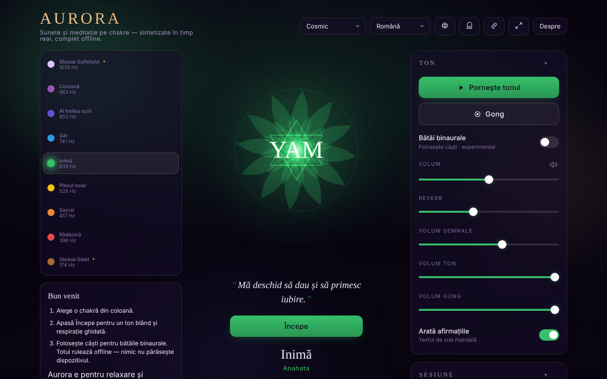

# Aurora

Chakra Sound & Meditation — tonuri, bătăi binaurale, ghid de respirație și călătorie prin chakre, într-un singur fișier HTML.

**Live:** https://chiuta.github.io/Aurora/

**Ultima actualizare:** 11 octombrie 2026

## Ce este

Aurora este un instrument contemplativ de sunet și meditație: alegi o chakră, iar aplicația generează în browser un ton (Web Audio API) cu frecvența asociată, o mandala animată, opțional bătăi binaurale, gong, clopoțel la interval și un ghid de respirație. Aplicația precizează în interfață că este pentru relaxare și contemplare, iar frecvențele și chakrele provin din tradiții spirituale, nu din medicină.

## Funcții

- Selecție de chakre cu informații despre frecvență, element, mantră, petale, solfeggio, „sense” și ton.
- Generare de ton, reglaj de volum, reverb, volume separate pentru indicații, ton și gong; gong la cerere.
- Bătăi binaurale (recomandat cu căști), cu presetări Delta 2 Hz, Theta 6 Hz, Alpha 10 Hz și altele.
- Sesiune cu durată setabilă; „Chakra journey” (călătorie automată prin chakre), opțiuni: echilibrare automată, includere transpersonală (9 chakre în loc de 7), parcurgere descendentă (de la coroană la rădăcină), clopoțel la interval.
- Ghid de respirație cu modele selectabile și indicații la schimbarea fazelor.
- Afirmații afișate sub mandala (opțional), mod simplu (ascunde controalele avansate), mod zen/ecran complet, ecran care rămâne aprins (Wake Lock, unde este suportat).
- Istoric al sesiunilor recente, presetări, temă.
- Fereastră „Gateway practices”, fereastră de scurtături și tutorial de respirație.
- Export / import / resetare a setărilor (fișier JSON).
- Titlul filei arată „▶ chakră · frecvență” cât timp sună tonul, iar metadatele Media Session (titlu, play/pauză) sunt setate local pentru controalele sistemului, unde browserul le afișează.
- Tipărire: foaia de stil de print păstrează doar titlul, afirmația și fișa chakrei selectate, plus notele de drepturi și avertisment, fără butoane.
- Interfață în 9 limbi: engleză, română, spaniolă, franceză, italiană, portugheză, catalană, hindi, arabă.

## Manual de utilizare

1. Deschide pagina și citește nota inițială; apasă „Got it” (sau echivalentul în limba aleasă). La prima rulare apare un ghid de întâmpinare („Welcome” / „Begin”).
2. Alege limba cu butonul de limbă din antet sau apasă `L` pentru a trece la următoarea.
3. Selectează o chakră (săgeți Sus/Jos schimbă chakra).
4. Apasă Spațiu pentru a porni/opri tonul; `G` lovește gongul.
5. Reglează volumul cu `+` / `-` sau din controalele „Volume”, „Reverb”, „Tone volume”, „Gong volume”.
6. Pentru bătăi binaurale, deschide secțiunea „Binaural beats”, alege „Beat” și folosește căști.
7. Pentru respirație, alege un model din „Breathing”; `B` trece la modelul următor; `?` deschide ghidul de respirație.
8. În „Session” setează „Duration” și, dacă dorești, „Chakra journey”.
9. Escape închide ferestrele și iese din modul zen.
10. Salvarea datelor: „Export settings” descarcă `aurora-settings.json`; „Import settings” îl reîncarcă; „Reset to defaults” revine la valorile implicite.

## Avertisment

Conținut contemplativ/de relaxare, nu medical. Chakrele, frecvențele asociate și „sunetele vindecătoare" provin din tradiții spirituale și nu au validare științifică; nu există dovezi solide că anumite frecvențe tratează afecțiuni sau că bătăile binaurale schimbă fiabil starea creierului. Nu înlocuiește sfatul medical. Aplicația afișează acest avertisment la prima rulare, în „About" și în subsolul paginii.

## Confidențialitate și rețea

- **Stocare locală:** `localStorage`, toate cheile cu prefixul `aurora.` (limbă, temă, volume, preferințe de sesiune, presetări, istoric, marcaje că notele au fost văzute). Dacă stocarea este blocată, aplicația afișează un avertisment.
- **Rețea:** în codul aplicației nu există `fetch`, CDN, scripturi sau resurse externe încărcate automat; nu am găsit analytics. Sunetul este sintetizat local.
- Aplicația conține o referință text către Centrul AmaneSer (amaneser.ro) în nota „About”, fără încărcare de resurse de acolo.

## Rulare locală / offline

Descarcă `index.html` și deschide-l în browser. Nu necesită internet pentru funcționare. Nu este nevoie de server.

## Licență

**Licență: nedeclarată de autor; toate drepturile rezervate până la o declarație contrară. Contact: alexio@trom.tf**
*License: not declared by the author; all rights reserved until stated otherwise. Contact: alexio@trom.tf*

Declarația apare și în antetul `index.html` și în subsolul aplicației (RO + EN).

## Drepturi și atribuire

- **Partea autorului:** codul, textele și designul aplicației (Alexio — Alexandru-Ionuț Chiuță). Orice licență declarată ulterior se va aplica doar acestei părți.
- **Terți / inspirație:** aplicația este inspirată de practica sunetelor pentru relaxare (de ex. Centrul AmaneSer, amaneser.ro — nu se încarcă resurse de acolo) și menționează practica „Gateway” (Institutul Monroe). Este un proiect independent; nu implică afiliere sau aprobare din partea lor și nu reprezintă poziția oficială a niciunei organizații.
- Drepturile asupra materialelor și numelor terților aparțin titularilor lor.
- **Rectificare / retragere:** dacă ești titular de drepturi sau persoană menționată și dorești corectarea sau retragerea, scrie la alexio@trom.tf; răspundem în 7 zile.

*Rights and attribution:* code, texts and design are the author's; any license declared later applies only to that part. Inspiration/mentions (Centrul AmaneSer, Monroe Institute "Gateway") imply no affiliation or endorsement; rights in third-party materials and names belong to their owners. Rights holders or mentioned persons: write to alexio@trom.tf for correction or removal; we reply within 7 days.

## Audit

Audit: 2026-10-10 — verificat cu Playwright și axe-core; CSP `default-src 'none'` confirmat; fără `fetch`/CDN. Rundă 3 (2026-10-11): declarație de licență nedeclarată + „Drepturi și atribuire” în aplicație și README. Corectate: depășire orizontală pe mobil, nume accesibile pentru butoanele de chakre; adăugat avertisment permanent în subsol. Rundă 2 (2026-10-11): meta description reformulată (fără „healing”: instrument de relaxare, nu tratament); `<html lang>` se actualizează deja la schimbarea limbii.

## Istoric / Changelog

### 11 octombrie 2026 (runda 7)
- Îmbunătățit: la prima deschidere (fără temă salvată) aplicația respectă preferințele sistemului: tema „light” dacă sistemul cere schema luminoasă, „contrast” dacă cere contrast mărit (`prefers-color-scheme` / `prefers-contrast`); alegerea manuală are prioritate și se păstrează. Verificat: 0 violări axe-core în temele light și contrast.
- Verificat, nu defect: butonul „Begin” se ascunde cât timp sună tonul (comportament intenționat; Play/Pauză rămâne vizibil) și reapare la pauză.

### 11 octombrie 2026 (runda 6)
- Securitate: CSP `script-src` pe hash sha256 al scriptului unic, fără `'unsafe-inline'` pentru scripturi (stilurile inline rămân permise).
- Adăugat: titlul filei și Media Session reflectă chakra și starea redării; foaie de stil pentru tipărire.

### 11 octombrie 2026
- Reparat: conținutul este acum încadrat în repere (`<main>`, `<footer>`), astfel încât regula axe-core „region” trece; 0 violări la 1280 și 360 px.
- Notă (neschimbată): asocierile chakră–frecvență/element/„sense” provin din tradiții spirituale, nu din surse științifice, așa cum spune nota afișată în aplicație; sunetul nu a putut fi evaluat auditiv în testele automate.

## Autor

Alexio — Alexandru-Ionuț Chiuță, contact: alexio@trom.tf

## English summary

Aurora is a single-file chakra sound and meditation tool: synthesized tones (Web Audio), binaural beats, gong, breathing guide, automatic chakra journey, session history, settings export/import and a 9-language UI. Preferences are kept in localStorage under the `aurora.` prefix; the app makes no network requests. It is for relaxation, not medicine.
