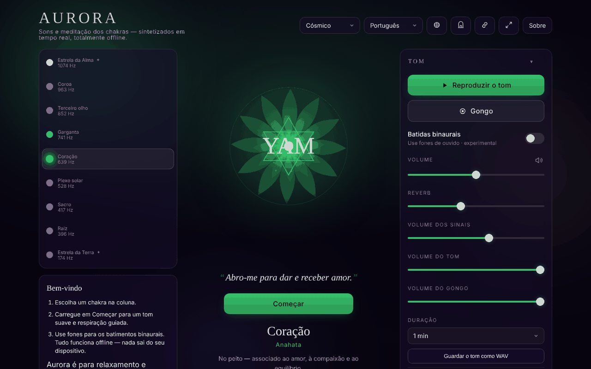

# Aurora

[English](README.md) · [Română](README.ro.md) · [Français](README.fr.md) · [Italiano](README.it.md) · [Español](README.es.md) · **Português** · [Deutsch](README.de.md) · [Magyar](README.hu.md)

**Versão:** 1.3.3 · **Última atualização:** 2026-10-22

Idiomas da interface: **Română, English, Français, Italiano, Español, Português (PT), Deutsch, Magyar, Català, हिन्दी, العربية**

Chakra Sound & Meditation — tons, batimentos binaurais, guia de respiração e viagem pelos chakras, num único ficheiro HTML.

**Aplicação online:** https://chiuta.github.io/Aurora/

## O que é

O Aurora é uma ferramenta contemplativa de som e meditação: escolhe um chakra, e a aplicação gera no navegador um tom (Web Audio API) com a frequência associada, um mandala animado, opcionalmente batimentos binaurais, um gongo, um sino a intervalos e um guia de respiração. A aplicação esclarece na interface que se destina ao relaxamento e à contemplação, e que as frequências e os chakras provêm de tradições espirituais, não da medicina.

## Funcionalidades

- Seleção de chakras com informação sobre frequência, elemento, mantra, pétalas, solfeggio, «sense» e tom.
- Geração de tom, regulação do volume, reverberação, volumes separados para as indicações, o tom e o gongo; gongo a pedido.
- Batimentos binaurais (recomendam-se auscultadores), com predefinições Delta 2 Hz, Theta 6 Hz, Alpha 10 Hz e outras.
- Sessão com duração configurável; «Chakra journey» (viagem automática pelos chakras), opções: equilíbrio automático, inclusão dos chakras transpessoais (9 chakras em vez de 7), percurso descendente (da coroa à raiz), sino a intervalos.
- Guia de respiração com padrões selecionáveis e indicações nas mudanças de fase.
- Afirmações apresentadas por baixo do mandala (opcional), modo simples (oculta os controlos avançados), modo zen/ecrã inteiro, ecrã que permanece ligado (Wake Lock, onde suportado).
- Histórico das sessões recentes, predefinições, tema.
- Janela «Gateway practices», janela de atalhos e tutorial de respiração.
- Exportação / importação / reposição das definições (ficheiro JSON).
- O título do separador mostra «▶ chakra · frequência» enquanto o tom soa, e os metadados da Media Session (título, reproduzir/pausa) são definidos localmente para os controlos do sistema, onde o navegador os apresentar.
- Impressão: a folha de estilo de impressão mantém apenas o título, a afirmação e a ficha do chakra selecionado, além das notas de direitos e de aviso, sem botões.
- Interface em 11 idiomas: inglês, romeno, espanhol, francês, italiano, português, alemão, húngaro, catalão, hindi, árabe.

## Novidades (1.1.0)

- **O tom atual como ficheiro WAV** (painel «Tone», secção «Audio file», oculta no modo simples): escolhe a duração (1, 2, 3 ou 5 minutos) e a aplicação gera, com `OfflineAudioContext`, o mesmo tom que o reproduzido (os mesmos osciladores, filtro e LFO), mais os batimentos binaurais se estiverem ativos, com a reverberação atual. Resultado: WAV estéreo, 16 bits, 32 kHz, normalizado a −1 dBFS, com fade-in de 1,5 s e fade-out de ~2,5 s; nome do tipo `aurora-heart-639hz-binaural6.wav`. **Não inclui** o gongo, o sino a intervalos nem as indicações de respiração. Os 5 minutos ocupam ~38 MB e são gerados em memória (em telemóveis antigos pode falhar: a aplicação diz então que o navegador não conseguiu gerar o ficheiro). A reverberação usa um impulso aleatório, pelo que dois ficheiros gerados em sequência não são idênticos bit a bit.
- **Código QR da cena** (painel «Session», «QR code of this scene»): o código contém o endereço público (`https://chiuta.github.io/Aurora/`, ou o da página atual se for servida por HTTPS) e um hash `#<chakra>&beat=<2|6|10>&breath=<padrão>`. Ao abrir, são aplicados o chakra, os batimentos binaurais (se a ligação os pedir) e o padrão de respiração; os valores desconhecidos são ignorados. Também se pode copiar a ligação. O padrão «custom» não está incluído na ligação (não pode ser representado). Gerado localmente; só aparece com o módulo QR.
- **Transparência** e **cópia de segurança `.fff.json`** (prima a versão na janela «About»): a janela padrão «sem fronteiras» com a rede (0 pedidos externos), as chaves `aurora.*`, as permissões e o SHA-256; a cópia de segurança, que pode ser cifrada, abrange todas as definições.

Os novos textos estão nos 11 idiomas da aplicação (EN, RO, ES, FR, IT, PT, DE, HU, CA, HI, AR); as traduções que não sejam EN/RO são automáticas e **não verificadas por falantes nativos**.

## O kit «fff-kit»

Módulos colados em `index.html`: `core`, `label`, `bundle`, `qr`. A janela «Transparência» do kit tem 8 idiomas (RO, EN, FR, IT, ES, PT, HU, DE); quando a aplicação está em CA, HI ou AR, aparece em inglês. Sem o kit, a aplicação funciona da mesma forma, mas sem o botão QR.

## Testes

`node tests/fff-r8.test.mjs` (Playwright, rede bloqueada): o ficheiro WAV é descarregado e analisado espectralmente no teste (cabeçalho, duração, nível, pico na frequência do chakra, L=220 Hz e R=220+beat Hz em binaural), a cena é codificada em QR, descodificada de volta e reaberta numa página limpa, 9 idiomas (incluindo o árabe RTL), axe-core 0 violações nos 3 temas e no modal, 360 px, sem o kit.

## Manual de utilização

1. Abra a página e leia a nota inicial; prima «Got it» (ou o equivalente no idioma escolhido). Na primeira execução surge um guia de boas-vindas («Welcome» / «Begin»).
2. Escolha o idioma com o botão de idioma do cabeçalho ou prima `L` para passar ao seguinte.
3. Selecione um chakra (as setas Cima/Baixo mudam o chakra).
4. Prima Espaço para iniciar/parar o tom; `G` toca o gongo.
5. Regule o volume com `+` / `-` ou nos controlos «Volume», «Reverb», «Tone volume», «Gong volume».
6. Para os batimentos binaurais, abra a secção «Binaural beats», escolha «Beat» e use auscultadores.
7. Para a respiração, escolha um padrão em «Breathing»; `B` passa ao padrão seguinte; `?` abre o guia de respiração.
8. Em «Session» defina a «Duration» e, se desejar, «Chakra journey».
9. Escape fecha as janelas e sai do modo zen.
10. Guardar os dados: «Export settings» descarrega `aurora-settings.json`; «Import settings» volta a carregá-lo; «Reset to defaults» regressa aos valores predefinidos.

## Aviso

Conteúdo contemplativo/de relaxamento, não médico. Os chakras, as frequências associadas e os «sons curativos» provêm de tradições espirituais e não têm validação científica; não existem provas sólidas de que certas frequências tratem doenças ou de que os batimentos binaurais alterem de forma fiável o estado do cérebro. Não substitui o aconselhamento médico. A aplicação apresenta este aviso na primeira execução, em «About» e no rodapé da página.

## Privacidade e rede

- **Armazenamento local:** `localStorage`, todas as chaves com o prefixo `aurora.` (idioma, tema, volumes, preferências de sessão, predefinições, histórico, marcas de que as notas foram vistas). Se o armazenamento estiver bloqueado, a aplicação apresenta um aviso.
- **Rede:** no código da aplicação não existem `fetch`, CDN, scripts nem recursos externos carregados automaticamente; não encontrei análise de utilização. O som é sintetizado localmente.
- A aplicação contém uma referência textual ao Centrul AmaneSer (amaneser.ro) na nota «About», sem carregar recursos de lá.

## Execução local / offline

Descarregue `index.html` e abra-o num navegador. Não precisa de internet para funcionar. Não é necessário servidor.

## Licença

MIT para o código e a estrutura da aplicação — veja o ficheiro `LICENSE`. As eventuais bibliotecas de terceiros incluídas no ficheiro mantêm as suas próprias licenças.

A declaração aparece também no cabeçalho de `index.html` e no rodapé da aplicação (RO + EN).

## Direitos e atribuição

- **Parte do autor:** o código, os textos e o design da aplicação (Alexio — Alexandru-Ionuț Chiuță). Qualquer licença declarada posteriormente aplicar-se-á apenas a esta parte.
- **Terceiros / inspiração:** a aplicação inspira-se na prática dos sons para relaxamento (p. ex. o Centrul AmaneSer, amaneser.ro — não se carregam recursos de lá) e menciona a prática «Gateway» (Monroe Institute). É um projeto independente; não implica afiliação nem aprovação da parte deles e não representa a posição oficial de nenhuma organização.
- Os direitos sobre os materiais e os nomes de terceiros pertencem aos respetivos titulares.
- **Retificação / retirada:** se for titular de direitos ou uma pessoa mencionada e desejar uma correção ou retirada, escreva para alexio@trom.tf; respondemos em 7 dias.

*Direitos e atribuição:* o código, os textos e o design são do autor; qualquer licença declarada posteriormente aplica-se apenas a essa parte. As inspirações/menções (Centrul AmaneSer, Monroe Institute «Gateway») não implicam afiliação nem aprovação; os direitos sobre os materiais e os nomes de terceiros pertencem aos respetivos titulares. Titulares de direitos ou pessoas mencionadas: escrevam para alexio@trom.tf para correção ou remoção; respondemos em 7 dias.

## Auditoria

Auditoria: 2026-10-10 — verificado com Playwright e axe-core; CSP `default-src 'none'` confirmada; sem `fetch`/CDN. Ronda 3 (2026-10-11): declaração de licença não declarada + «Direitos e atribuição» na aplicação e no README. Corrigidos: excesso horizontal no telemóvel, nomes acessíveis para os botões dos chakras; adicionado um aviso permanente no rodapé. Ronda 2 (2026-10-11): meta description reformulada (sem «healing»: ferramenta de relaxamento, não um tratamento); `<html lang>` já é atualizado ao mudar o idioma.

## Histórico / Registo de alterações

- 1.3.3 — 2026-10-22: As etiquetas dos chakras, as dicas dos painéis e as etiquetas de metadados usam texto de pelo menos 12 px; áreas de toque de pelo menos 24 px (caixas de seleção, ligações do rodapé).

- 1.3.2 — 2026-10-22: **correção**: o nome acessível do seletor de chakras segue agora o idioma da interface.
### 1.3.1 — 2026-10-22
- O alemão e o húngaro têm agora traduzidos os nomes, elementos, afirmações, descrições e sentidos dos chakras (continuavam em inglês).

### 19 de outubro de 2026 (v1.2.0)
- Botão «Versão ambiente no CalmWaves» (novo separador): passa o objetivo (sono/relaxamento/concentração conforme o batimento binaural, «meditação» sem binaural), a duração e a frequência do chakra para o endereço do CalmWaves (`?v=…&from=aurora`). Apenas uma ligação, sem pedidos de rede.

### 14 de outubro de 2026 (v1.1.0)
- Novo: o tom atual como WAV, código QR da cena (chakra + batimentos binaurais + respiração) e hash alargado `#chakra&beat=…&breath=…`, janela «Transparência» (fff-kit: core, label, bundle, qr); `tests/fff-r8.test.mjs`. CSP: hash do script recalculado.

### 1.0.0 — 2026-10-12
- A versão e a data da última atualização são mostradas na aplicação (janela «Acerca de», nos 11 idiomas).

### 11 de outubro de 2026 (ronda 7)
- Melhorado: na primeira abertura (sem tema guardado) a aplicação respeita as preferências do sistema: tema «light» se o sistema pedir o esquema claro, «contrast» se pedir contraste aumentado (`prefers-color-scheme` / `prefers-contrast`); a escolha manual tem prioridade e é mantida. Verificado: 0 violações axe-core nos temas light e contrast.
- Verificado, não é um defeito: o botão «Begin» fica oculto enquanto o tom soa (comportamento intencional; Reproduzir/Pausa permanece visível) e reaparece em pausa.

### 11 de outubro de 2026 (ronda 6)
- Segurança: CSP `script-src` sobre o hash SHA-256 do script único, sem `'unsafe-inline'` para scripts (os estilos inline continuam permitidos).
- Adicionado: o título do separador e a Media Session refletem o chakra e o estado da reprodução; folha de estilo de impressão.

### 11 de outubro de 2026
- Corrigido: o conteúdo está agora enquadrado em marcos (`<main>`, `<footer>`), pelo que a regra «region» do axe-core passa; 0 violações a 1280 e 360 px.
- Nota (inalterada): as associações chakra–frequência/elemento/«sense» provêm de tradições espirituais, não de fontes científicas, como diz a nota apresentada na aplicação; o som não pôde ser avaliado de ouvido nos testes automáticos.

## Autor

Alexio — Alexandru-Ionuț Chiuță, contacto: alexio@trom.tf

## Resumo

O Aurora é uma ferramenta de som e meditação de chakras num único ficheiro: tons sintetizados (Web Audio), batimentos binaurais, gongo, guia de respiração, viagem automática pelos chakras, histórico de sessões, exportação/importação de definições e uma interface em 11 idiomas. As preferências são guardadas em localStorage com o prefixo `aurora.`; a app não faz pedidos de rede. Destina-se ao relaxamento, não à medicina.

Novidades da 1.1.0: guardar o tom atual como WAV estéreo de 16 bits (1–5 min, gerado offline no navegador; sem gongo, sinos nem indicações de respiração), um código QR/ligação para a cena atual (chakra + batimento binaural + padrão de respiração) e a caixa de diálogo «Transparência». As traduções que não sejam EN/RO das novas cadeias são automáticas e não verificadas por falantes nativos.
